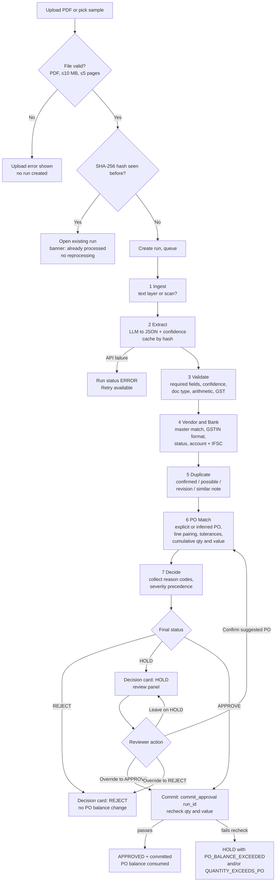
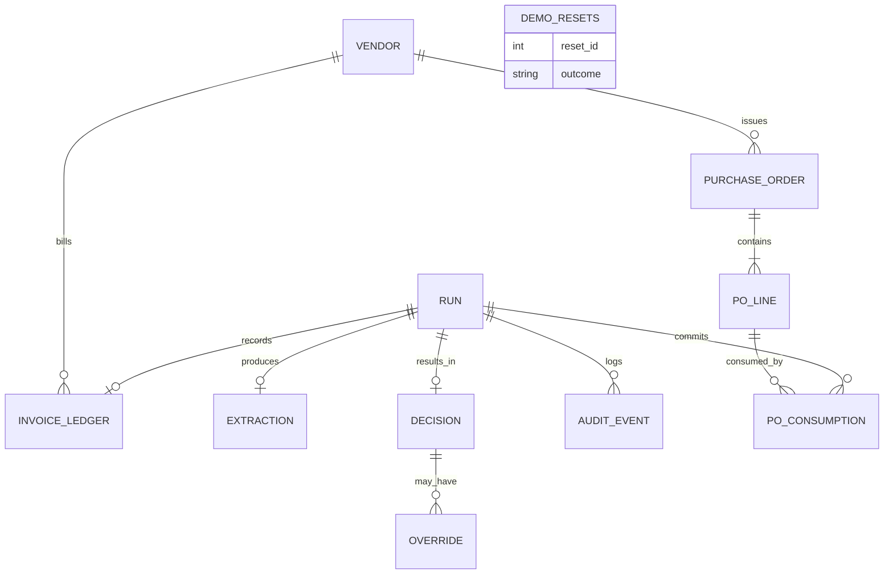
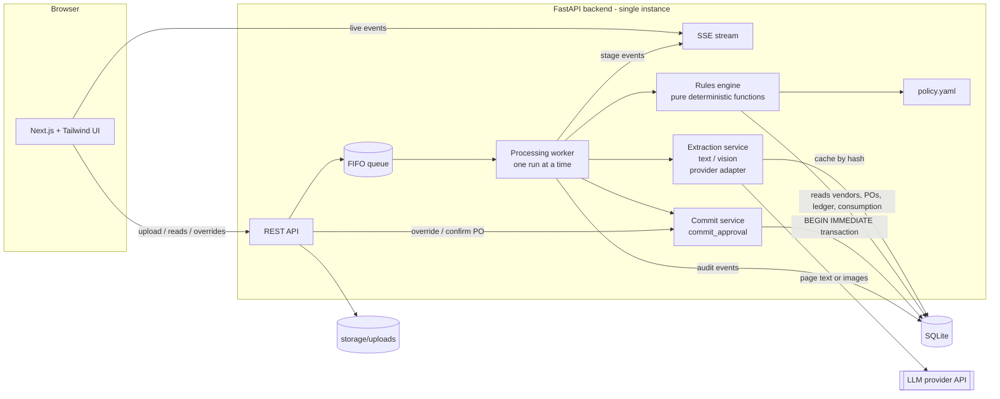

# ClearMatch AP: Product Requirements Document

**Zamp AI Solutions Analyst Case Study · PS-1 Invoice Processing**

| Field | Value |
|---|---|
| Product (working name) | ClearMatch AP |
| Version | 1.2.1 (Final; consistency patch, same filename) |
| Status | Final, frozen for build. OD-1 to OD-8 accepted without modification (Section 18). v1.2 adds six documentation corrections only (see Revision row) |
| Date | 2 November 2026 |
| Source documents | `zamp-case-study-notes.md` (original plan), `Zamp_PS1_Critical_Review_and_Final_Recommendations.md` (critical review; source of truth where it changes the original) |
| Build window | 7 days, solo developer |
| Revision (v1.2) | (1) FR-064 description normalisation keeps decimal points between digits (DEC-003); (2) `demo_resets` schema, append-only rules, atomic reset and persistent failure logging; (3) reset security: server-only token, intentionally public UI route limited to synthetic data, rate limiting and typed confirmation; (4) T-02 invoice date fixed at 29 Oct 2026; (5) trusted-contact phone/email excluded from `GET /api/vendors`; (6) `frontend/app/api/demo/reset/route.ts` added to folder structure. No business rule, threshold, test outcome or frozen decision changed. **v1.2.1 patch (documentation only):** TOC and roadmap wording for frozen decisions; `/api/health`, `/api/meta`, `/api/seed-status` added to §12.3; `extraction_cache` entity defined so FR-014 (cache survives reset) and FR-116 (runs deleted) are both satisfiable; versioned migrations named in §12.4; note on the shared `/api/demo/reset` path across the two origins. |

---

## Executive summary

ClearMatch AP takes a vendor invoice PDF and returns one of three decisions, **APPROVE, HOLD or REJECT**, with every check, value and reason visible. An LLM reads the invoice and returns structured fields with confidence scores. Deterministic backend rules then validate arithmetic and GST, check the vendor and bank details against the vendor master, detect duplicates in three tiers, match the invoice to a purchase order (two-way match) with scoped tolerances, and check the cumulative PO balance. Only approved invoices consume PO balance, through a single idempotent commit function that rechecks the balance at the moment of approval.

The product is built to demonstrate disciplined automation: nothing uncertain is approved silently, nothing legitimate is rejected on weak evidence, and every decision can be explained from the evidence on screen. REJECT is reserved for two established conditions (confirmed duplicate, blocked vendor). Every uncertain or risky case is a HOLD with a reason code, evidence and a next action for a human reviewer.

Scope is deliberately limited to what can be built and demonstrated reliably in seven days: PDF upload (no email), INR and GST only, synthetic data, two-way matching (no goods receipt), sequential processing, and no authentication.

**Core principle:** AI reads the invoice. Deterministic rules make the decision. Humans resolve uncertainty and high-risk exceptions.

---

## Table of contents

1. Document overview
2. Problem statement
3. Goals and non-goals
4. Target users and user stories
5. End-to-end product workflow
6. Functional requirements
7. Business rules and decision matrix
8. Data requirements and schemas
9. Calculation and validation logic
10. UI/UX requirements
11. Non-functional requirements
12. Technical architecture
13. Edge cases and test scenarios
14. Assumptions and limitations
15. Scope prioritisation
16. Seven-day implementation roadmap
17. Demo and evaluation plan
18. Product decisions (frozen)
19. Consistency audit
20. Implementation readiness checklist

**Convention used throughout:** values marked **[PA]** are *prototype assumptions*. They are thresholds or policies chosen for this prototype, not Zamp policies and not universal accounting rules. All [PA] values live in `policy.yaml` and are listed in Section 14.

---

## 1. Document overview

| Item | Detail |
|---|---|
| Product name | ClearMatch AP (working name) |
| Version / status | v1.2 Final, frozen for build |
| Objective of this document | Single source of truth for building the PS-1 prototype. An engineer (or Claude Code) should be able to implement every behaviour without asking for clarification. |
| Product summary | Web application that processes one vendor invoice PDF at a time through seven stages (Ingest, Extract, Validate, Vendor & Bank, Duplicate, PO Match, Decide) and a commit step, producing APPROVE / HOLD / REJECT with reason codes, evidence and an audit trail. |
| Target user | Accounts Payable executive / invoice reviewer at a mid-size Indian company that receives vendor invoices as PDFs and maintains purchase orders. |
| Buyer persona (for demo narrative) | AP manager / finance controller who needs nothing wrong paid, nothing paid twice, and an audit trail for every decision. |
| Primary use case | AP executive uploads an invoice PDF; the system decides automatically when every check passes, and routes everything else to a human with the exact reason and evidence. |
| Value proposition | ClearMatch AP clears routine invoices automatically and puts every exception in front of a reviewer with the exact evidence needed to resolve it in under a minute. |

---

## 2. Problem statement

### 2.1 The AP problem
A mid-size company receives a steady flow of vendor invoices by email as PDFs. For each one, an AP executive opens the file, reads the invoice number, vendor, amounts and PO reference, finds the matching purchase order in a spreadsheet, compares quantities and prices, checks the arithmetic, and decides whether to pay, hold or return the invoice.

### 2.2 Why manual processing is inefficient and error-prone
- **Every vendor formats invoices differently.** Some are digital PDFs, some are scans. Lines may be itemised or bundled; tax may be shown separately or included; discounts, freight and round-off lines appear inconsistently.
- **Information is often missing or implicit.** Invoices may lack a PO reference or show it in an unexpected place.
- **The work is repetitive.** Repetition is exactly where a tired reviewer misses a small price change, an altered bank account or a resubmitted invoice.
- **The audit trail is informal.** Why an invoice was approved often lives in someone's memory or inbox.

### 2.3 Why PO matching matters
A purchase order is the company's record of what it agreed to buy, in what quantity, at what price. Matching an invoice to its PO confirms that the company is being charged for something it ordered, at the agreed price, without exceeding the agreed quantity or value. Without the match, the company pays whatever the vendor bills.

### 2.4 Why these errors create financial risk
| Risk | What happens |
|---|---|
| Incorrect approval | Paying for items not ordered, at prices above agreement, or with arithmetic errors in the vendor's favour. |
| Duplicate payment | The same invoice is paid twice, often because it was resubmitted in a different format or with a slightly altered number. Recovering the money requires the vendor's cooperation. |
| Bank-detail change | A known invoice-fraud pattern: a legitimate-looking invoice carries different bank details, and the payment goes to a fraudster. |
| PO overrun | A vendor splits billing across several invoices; each looks acceptable on its own, but together they exceed the PO. |
| False rejection | A legitimate invoice (e.g. a recurring monthly bill) is rejected, damaging the vendor relationship and delaying payment. |

### 2.5 What ClearMatch AP solves
- Reads varied invoice layouts (digital and scanned) into one structured format.
- Runs every check a careful AP executive would, the same way every time.
- Approves only when every check passes; holds everything uncertain with a specific reason; rejects only on established conditions.
- Remembers prior approved invoices, so cumulative PO overruns and duplicates are caught.
- Records every decision, the evidence behind it and every human override.

This document makes no market-size or ROI claims.

---

## 3. Goals and non-goals

### 3.1 Product goals
| ID | Goal |
|---|---|
| PG-1 | Produce a correct APPROVE / HOLD / REJECT decision for every supported invoice, determined only by deterministic rules. |
| PG-2 | Make every decision explainable: each check shows source values, expected value, actual value, variance, allowed variance and result. |
| PG-3 | Avoid false approvals: no invoice is approved when a critical field is uncertain, a tolerance is breached, the bank details differ, or the PO balance is insufficient. |
| PG-4 | Avoid false rejections: weak signals (similar amount, revision suffix, unknown vendor) lead to HOLD, never REJECT. |
| PG-5 | Guarantee PO balance integrity: only approved invoices consume balance, exactly once, with a recheck at commit. |
| PG-6 | Show processing live, stage by stage. |

### 3.2 User goals (AP executive)
- Spend time only on exceptions, not routine invoices.
- Understand within seconds why an invoice was held or rejected and what to do next.
- Never accidentally approve a duplicate or a changed bank account.
- Have a defensible record of every override.

### 3.3 Business goals for this case study
- Demonstrate a working process that runs live on real inputs (PDFs).
- Demonstrate deliberate edge-case handling across all three outcomes.
- Demonstrate an intuitive UI with a live run view and a dashboard, as required by the brief.
- Demonstrate clear judgment about AI versus deterministic responsibilities.
- Run reliably and repeatably in a live interview.

### 3.4 Non-goals and explicit exclusions
| Excluded | Reason / status |
|---|---|
| Email ingestion | Upload only. P2. |
| ERP integration or payment posting | No payment is executed. P2. |
| GRN / three-way matching | Two-way match only; goods receipt not verified. P1 stretch, not committed. |
| Live GST portal verification | GSTIN checked for format and against vendor master only. P2. |
| Bank account ownership verification | Compared against vendor master only. P2. |
| Role-based permissions / authentication | Reviewer name is typed; no login. P2. |
| AI-assisted line description matching | Deterministic item-code and alias matching only. P2. |
| Concurrent processing | Sequential processing by design. |
| Multi-currency, multi-country tax | INR and GST only. P2. |
| Credit-note processing workflow | Detected and held (P1), not processed. P2. |
| Reviewer correction of extracted fields | Not built; see Open Product Decision OD-8. |
| Supplier communication | No messages sent to vendors. P2. |

---

## 4. Target users and user stories

### 4.1 Primary persona: AP executive / reviewer
| Attribute | Description |
|---|---|
| Role | Processes incoming vendor invoices; resolves exceptions; escalates to procurement or treasury where needed. |
| Context | Works from a queue; needs speed but is accountable for errors. |
| Pain points | Repetitive lookups, manual arithmetic, inconsistent formats, fear of paying duplicates or fraudulent bank accounts. |
| Needs from the product | Automatic handling of clean invoices, clear evidence for exceptions, safe override with audit, visibility of PO balances. |

Secondary persona (narrative only, no separate features): AP manager reviewing the dashboard and audit trail.

### 4.2 User stories
| ID | Story | Maps to |
|---|---|---|
| US-01 | As an AP executive, I want to upload an invoice PDF or pick a prepared sample, so that I can start processing without manual data entry. | FR-001, FR-002 |
| US-02 | As an AP executive, I want the system to recognise a file I already uploaded, so that it isn't processed twice or consume PO balance twice. | FR-003, FR-004 |
| US-03 | As an AP executive, I want to watch each processing stage complete live, so that I know what the system is doing and where it stopped. | FR-083, FR-114 |
| US-04 | As an AP executive, I want to see the extracted invoice fields with confidence scores next to the PDF, so that I can trust or question what was read. | FR-013, FR-110 |
| US-05 | As an AP executive, I want to see which PO and PO lines the invoice was matched to, with expected versus actual quantities and prices, so that I can understand the match. | FR-060 to FR-068 |
| US-06 | As an AP executive, I want every HOLD to state the reason code, the evidence and the next action, so that I can resolve it without re-investigating. | FR-080 to FR-084 |
| US-07 | As an AP executive, I want possible duplicates shown side by side with the original invoice, so that I can confirm or dismiss them. | FR-050 to FR-055 |
| US-08 | As an AP executive, I want changed bank details flagged as a security exception with the trusted contact on record, so that I verify through a safe channel and never through details printed on the invoice. | FR-040 to FR-045 |
| US-09 | As an AP executive, I want to override a HOLD with a mandatory reason, so that I can resolve exceptions while leaving an audit record. | FR-100 to FR-106 |
| US-10 | As an AP executive, I want to confirm a suggested PO for an invoice that had no PO number, so that it can be re-checked against that PO and approved if clean. | FR-061, FR-103 |
| US-11 | As an AP executive, I want an override blocked if the PO no longer has enough balance, so that approvals made later can't overrun a PO. | FR-091, FR-105 |
| US-12 | As an AP executive, I want to view the full audit trail of a run (stages, decision, overrides, commit), so that I can explain any decision later. | FR-112 |
| US-13 | As an AP manager, I want dashboard metrics (status counts, value on hold, exceptions by reason, PO balances) clearly labelled as demo data, so that I understand the queue without mistaking demo numbers for performance claims. | FR-111, FR-115 |
| US-14 | As a demo operator, I want to reset all data to the seed state, so that every rehearsal and live demo starts from the same known balances. | FR-116 |
| US-15 | As an AP executive, I want to see the active policy thresholds, so that I know which rules produced a decision. | FR-117 |

---

## 5. End-to-end product workflow

### 5.1 Overview
`Ingest → Extract → Validate → Vendor & Bank Check → Duplicate Check → PO Matching → Decide → Commit`

The first seven are **processing stages** shown in the live view. **Commit** is a post-decision step that runs only when the decision is APPROVE (automatically, or after a reviewer override or PO confirmation).

**Stage continuation rule [PA]:** after Extract succeeds, all stages run where their inputs are available, so the reviewer sees all problems at once, not just the first. A stage whose prerequisite is missing is marked **Not Checked** with the reason (e.g. "Vendor not identified"). The final status is determined by severity across all reason codes (Section 7.3).

**Processing error vs decision [PA]:** if ingestion or the LLM call fails technically (API error, timeout, unreadable file), the run ends in run status `ERROR` with a Retry action. An ERROR is not a business decision and never consumes PO balance.

### 5.2 Workflow diagram



### 5.3 Stage-by-stage specification

#### Stage 1: Ingest
| Aspect | Specification |
|---|---|
| Input | Validated PDF file and its SHA-256 hash. |
| Processing | Extract the text layer with a PDF text library (e.g. pdfplumber). If the text layer has fewer than 50 non-whitespace characters per page on average **[PA]**, classify as scanned and render pages to images (e.g. 200 DPI) for the vision path. |
| Output | `ingest_method` = `text` or `vision`; page text or page images; page count. |
| Possible stage status | Passed (method chosen). Failed only on technical error (run → ERROR). |
| Failure scenarios | Corrupt/encrypted PDF; rendering failure → run ERROR, message "File could not be read", Retry. |
| What the user sees | "Digital PDF, text layer read (2 pages)" or "Scanned document, sent to vision model (1 page)". |

#### Stage 2: Extract
| Aspect | Specification |
|---|---|
| Input | Page text or images; extraction schema (Section 8.4). |
| Processing | If an extraction exists in the cache for this file hash, reuse it (`extraction_cached = true`). Otherwise call the configured LLM provider at temperature 0 with the strict JSON schema; validate the response against the schema; retry once on malformed JSON **[PA]**. Store result in cache keyed by hash. |
| Output | Invoice extraction object with per-field `value` and `confidence` (0–1), `document_type`, `currency`. |
| Possible stage status | Passed (schema-valid extraction returned). The stage does not judge field quality; Stage 3 does. |
| Failure scenarios | API error/timeout; malformed JSON twice → run ERROR with Retry. |
| What the user sees | Table of extracted fields with confidence chips (green ≥ 0.85, amber < 0.85), provider/model name, "Cached" badge if reused. |

#### Stage 3: Validate
| Aspect | Specification |
|---|---|
| Input | Extraction object; policy thresholds. |
| Processing | (a) Required fields present; (b) critical-field confidence ≥ 0.85 and deterministic corroboration (Section 9.8); (c) invoice date plausibility; (d) document type = tax invoice and currency = INR (P1); (e) four arithmetic equations with ₹1 allowance; (f) tax-component check where rates are present; (g) GST regime check (P1). |
| Output | Check results with evidence; reason codes `MISSING_REQUIRED_FIELD`, `LOW_EXTRACTION_CONFIDENCE`, `UNSUPPORTED_DOCUMENT` (P1), `ARITHMETIC_MISMATCH`, `TAX_REGIME_MISMATCH` (P1). |
| Possible stage status | Passed; Failed (`ARITHMETIC_MISMATCH`, `MISSING_REQUIRED_FIELD`, `UNSUPPORTED_DOCUMENT`, `TAX_REGIME_MISMATCH`); Needs Review (`LOW_EXTRACTION_CONFIDENCE`). |
| Failure scenarios | Arithmetic does not reconcile; field missing; field below threshold; unsupported document. |
| What the user sees | Each equation as "expected vs actual, variance, allowed ±₹1, result". |

#### Stage 4: Vendor & Bank Check
| Aspect | Specification |
|---|---|
| Input | Extracted vendor GSTIN, vendor name, bank account, IFSC; vendor master. |
| Processing | Validate GSTIN format; identify vendor by GSTIN, else by normalised legal name; check vendor status; compare full bank account number and IFSC with the vendor master if present on the invoice. |
| Output | `vendor_id` or null; codes `VENDOR_NOT_FOUND`, `VENDOR_BLOCKED`, `BANK_DETAILS_MISMATCH`; labels "Format valid", "Matches vendor master". |
| Possible stage status | Passed; Failed (`VENDOR_BLOCKED`); Needs Review (`VENDOR_NOT_FOUND`, `BANK_DETAILS_MISMATCH`). Bank sub-check Not Checked if invoice has no bank details or vendor not identified. |
| Failure scenarios | Vendor unknown; vendor blocked; bank details differ. |
| What the user sees | Vendor comparison (invoice vs master); masked bank comparison; red security banner on mismatch with trusted contact. |

#### Stage 5: Duplicate Check
| Aspect | Specification |
|---|---|
| Input | `vendor_id`, raw and normalised invoice number, invoice date, total, line signature; invoice ledger. |
| Processing | Apply the three duplicate tiers and the revision-suffix rule (Section 9.6). |
| Output | Codes `CONFIRMED_DUPLICATE`, `POSSIBLE_DUPLICATE`, `POSSIBLE_REVISION`; informational "similar invoice exists" note; link(s) to matched ledger entries. |
| Possible stage status | Passed (with or without informational note); Failed (`CONFIRMED_DUPLICATE`); Needs Review (`POSSIBLE_DUPLICATE`, `POSSIBLE_REVISION`); Not Checked if vendor not identified. |
| Failure scenarios | Resubmitted invoice; near-duplicate; revised invoice. |
| What the user sees | Side-by-side comparison with the matched invoice and its status. |

#### Stage 6: PO Matching
| Aspect | Specification |
|---|---|
| Input | `vendor_id`, PO reference (if any), line items, taxable value; PO master and lines; PO consumption ledger; policy tolerances. |
| Processing | Explicit PO lookup or candidate inference; line pairing (item code → normalised description/alias); per-line unit-price check (≤ PO price × 1.01); cumulative quantity check per PO line (≤ PO qty); cumulative PO value check (≤ PO total + min(1% of PO total, ₹1,000)). |
| Output | Matched PO (or candidates), line pairings, codes `PO_NOT_FOUND`, `PO_INFERRED`, `LINE_ITEM_UNMATCHED`, `UNIT_PRICE_VARIANCE`, `QUANTITY_EXCEEDS_PO`, `PO_BALANCE_EXCEEDED`. |
| Possible stage status | Passed; Failed (`LINE_ITEM_UNMATCHED`, `UNIT_PRICE_VARIANCE`, `QUANTITY_EXCEEDS_PO`, `PO_BALANCE_EXCEEDED`); Needs Review (`PO_NOT_FOUND`, `PO_INFERRED`); Not Checked if vendor not identified. |
| Failure scenarios | No PO; unpaired line; price over tolerance; cumulative overrun. |
| What the user sees | PO header (total, previously approved, this invoice, remaining, allowed overrun) and a line diff table. |

#### Stage 7: Decide
| Aspect | Specification |
|---|---|
| Input | All reason codes and stage results. |
| Processing | Final status = REJECT if any REJECT-severity code; else HOLD if any HOLD-severity code; else APPROVE (Section 7.3). Build a plain-English summary sentence per code. |
| Output | Decision record (status, codes, evidence, notes, next actions, policy version). |
| Possible stage status | Passed (decision produced). |
| Failure scenarios | None in business terms. |
| What the user sees | Large status badge, reason codes, summary sentences, next action. |

#### Commit (post-decision)
| Aspect | Specification |
|---|---|
| Input | `run_id` of an APPROVE decision (auto or reviewer). |
| Processing | `commit_approval(run_id)` in one SQLite transaction: no-op if already committed; recompute cumulative quantity and value for the PO from committed approvals; if still within limits, insert consumption rows and mark committed; if not, do not commit and convert the decision to HOLD with the failing code(s). |
| Output | `committed = true` with consumption rows, or HOLD with `PO_BALANCE_EXCEEDED` / `QUANTITY_EXCEEDS_PO`. |
| What the user sees | "Committed: PO-1042 remaining balance ₹30,000 → updated" or "Override blocked: remaining balance insufficient". |

---

## 6. Functional requirements

Each requirement lists: description, behaviour, inputs → outputs, business rules, acceptance criteria (AC) and priority. Priorities follow the critical review: **P0** must build, **P1** only if P0 is stable, **P2** future.

### A. Invoice ingestion

#### FR-001 · PDF upload and file validation · P0
- **Description:** The user uploads one invoice PDF via drag-and-drop or file picker.
- **Behaviour:** The backend validates the file before creating a run. Invalid files are rejected at upload with a message; no run is created.
- **Inputs → Outputs:** file → `{run_id, existing: false}` or validation error.
- **Rules:** accepted type PDF only (MIME `application/pdf` **and** file starts with `%PDF`); max size 10 MB **[PA]**; max 5 pages **[PA]**; encrypted PDFs rejected.
- **AC:**
  1. Uploading a valid PDF creates a run and navigates to the live processing screen.
  2. Uploading a `.png`, a renamed `.txt`, an encrypted PDF, a file > 10 MB or a PDF > 5 pages shows a specific error and creates no run.

#### FR-002 · Sample invoice picker · P0
- **Description:** The inbox lists the prepared demo invoices (Section 13) so the operator can process them with one click.
- **Behaviour:** Selecting a sample submits that file through exactly the same path as FR-001 (same hashing, same pipeline).
- **Inputs → Outputs:** sample name → `{run_id, existing}`.
- **Rules:** samples are files stored server-side; no special-case logic.
- **AC:** processing a sample produces identical results to uploading the same file manually.

#### FR-003 · SHA-256 hashing and duplicate-file detection · P0
- **Description:** Every accepted file is hashed (SHA-256) before a run is created.
- **Behaviour:** If the hash matches an existing run, no new run is created.
- **Inputs → Outputs:** file bytes → `file_hash`; lookup result.
- **Rules:** `runs.file_hash` is unique. File-hash matching is a **processing (idempotency) control**, separate from business-level duplicate detection (FR-051 to FR-055).
- **AC:**
  1. Uploading the same file twice yields one run.
  2. Database contains one run row per distinct hash.

#### FR-004 · Existing-run display · P0
- **Description:** When a file hash matches, the user is taken to the existing run.
- **Behaviour:** Upload response returns `{run_id: <existing>, existing: true}`; UI shows the decision screen with a banner: "This exact file was already processed in Run #14 on 2 Nov, 14:05. It was not processed again."
- **Rules:** no extraction call, no stage re-execution, no PO balance change.
- **AC:** re-uploading a file after it was approved leaves PO consumption totals unchanged.

#### FR-005 · Run creation and sequential queue · P0
- **Description:** Each new file creates a run with status `QUEUED`, processed by a single worker in arrival order.
- **Behaviour:** Run status transitions `QUEUED → PROCESSING → DECIDED` or `ERROR`. Only one run is `PROCESSING` at any time.
- **Rules:** one in-process worker with a FIFO queue. See FR-093.
- **AC:** submitting three samples quickly results in sequential processing; the inbox shows queued runs as "Queued".

### B. Invoice extraction

#### FR-010 · Text-first ingestion · P0
- **Description:** Read the PDF text layer first.
- **Behaviour:** If average non-whitespace characters per page ≥ 50 **[PA]**, use text path; pass page text to the LLM.
- **Inputs → Outputs:** PDF → `ingest_method = text`, page text.
- **AC:** a digital PDF is labelled "Digital PDF, text layer read".

#### FR-011 · Vision fallback for scanned documents · P0
- **Description:** If the text layer is insufficient, send rendered page images to a vision-capable model.
- **Behaviour:** Render each page at 200 DPI **[PA]**; send images with the same schema.
- **Inputs → Outputs:** PDF → `ingest_method = vision`, page images.
- **AC:** the scanned demo invoice extracts invoice number, vendor GSTIN and total correctly and is labelled "Scanned document".

#### FR-012 · Structured extraction schema · P0
- **Description:** The LLM must return JSON conforming to the extraction schema in Section 8.4.
- **Behaviour:** Response is validated against the schema (e.g. Pydantic). Missing optional fields are `null`, never invented.
- **Rules:** the prompt instructs the model to return `null` for any field not printed on the document and not to compute values that are not printed (e.g. do not calculate a total that is not shown).
- **AC:**
  1. All test PDFs in Section 13 return schema-valid JSON.
  2. An invoice with no PO reference returns `po_reference.value = null`.

#### FR-013 · Field-level confidence scores · P0
- **Description:** Every extracted scalar field and every line-item field carries `confidence` between 0 and 1.
- **Rules:** confidence is a **model-reported signal, not a calibrated probability** (FR-017).
- **AC:** the decision screen shows a confidence value next to each extracted field.

#### FR-014 · Extraction caching by file hash · P0
- **Description:** Store each successful extraction keyed by file hash; reuse on any later run of the same hash.
- **Behaviour:** Cache survives demo reset (FR-116) **[PA]** so demo outputs remain identical across rehearsals.
- **AC:**
  1. Second processing of a hash (after reset) makes no LLM call and shows a "Cached extraction" badge.
  2. Extracted values are byte-identical across runs.

#### FR-015 · Provider-agnostic LLM configuration · P0
- **Description:** The LLM provider and model are set in configuration (`LLM_PROVIDER`, `LLM_MODEL`, provider API key env var).
- **Behaviour:** Extraction service exposes one interface; provider adapters implement it (minimum one adapter; second adapter P1).
- **AC:** changing the configured provider requires no code changes outside the adapter and config.

#### FR-016 · Deterministic extraction settings · P0
- **Description:** Temperature 0; strict schema; one retry on malformed JSON **[PA]**.
- **AC:** temperature is 0 in every extraction request (verifiable in logs).

#### FR-017 · Critical-field confidence threshold and corroboration · P0
- **Description:** Critical fields must have confidence ≥ **0.85** **and** pass deterministic corroboration (Section 9.8). Confidence alone never qualifies a critical field.
- **Critical fields:** invoice number, invoice date, vendor identity (GSTIN or vendor name), total, PO reference (only when present), each line item's quantity and unit price.
- **Rules:**
  - Any critical field with confidence < 0.85 → `LOW_EXTRACTION_CONFIDENCE` (HOLD), even if corroborated.
  - A critical field that is confident but fails corroboration raises the corroborating check's own code (e.g. total fails equation 4 → `ARITHMETIC_MISMATCH`; GSTIN not in master → `VENDOR_NOT_FOUND`).
  - Both conditions on the same field → both codes are shown.
- **AC:** an invoice whose total has confidence 0.70 is held with `LOW_EXTRACTION_CONFIDENCE` even if arithmetic reconciles.

#### FR-018 · Extraction failure handling · P0
- **Description:** Technical failure of the extraction call.
- **Behaviour:** After one retry, run status = `ERROR`, message shown, "Retry" button re-runs the pipeline for the same `run_id`.
- **AC:** simulated API failure produces ERROR, not HOLD; Retry completes the run without creating a new run.

### C. Invoice validation

#### FR-020 · Required fields · P0
- **Description:** Mandatory fields **[PA]**: invoice number, invoice date, vendor GSTIN **or** vendor name, total, at least one line item.
- **Behaviour:** Any missing mandatory field → `MISSING_REQUIRED_FIELD` (HOLD) naming the field.
- **AC:** an invoice without an invoice number is held with "Missing required field: invoice number".

#### FR-021 · Invoice date plausibility · P0
- **Description:** Invoice date must parse, must not be in the future, and must not be more than 365 days before the processing date **[PA]**.
- **Behaviour:** Failure is treated as failed corroboration of the date → `LOW_EXTRACTION_CONFIDENCE` with message "Invoice date implausible: check the PDF" **[PA]** (no dedicated reason code exists).
- **AC:** an invoice dated next month is held with this message.

#### FR-022 · Document type and currency · P1
- **Description:** Extraction returns `document_type` (`tax_invoice`, `credit_note`, `proforma`, `other`) and `currency`.
- **Behaviour:** If `document_type ≠ tax_invoice` or `currency ≠ INR` → `UNSUPPORTED_DOCUMENT` (HOLD); stages 4–6 marked Not Checked with "Unsupported document".
- **Rules:** schema fields are P0 (always extracted); the rule is P1. See OD-7.
- **AC:** the credit-note sample is held with `UNSUPPORTED_DOCUMENT`.

#### FR-023 · Invoice arithmetic reconciliation · P0
- **Description:** Four equations, each with a **₹1 allowance** (Section 9.1):
  1. Σ(line qty × unit price) = subtotal
  2. subtotal − discount = taxable value
  3. taxable value × rate = each tax component (FR-024)
  4. taxable value + CGST + SGST + IGST + Σ other charges + round-off = total
- **Behaviour:** Any equation outside ±₹1 → `ARITHMETIC_MISMATCH` (HOLD), evidence names the failed equation.
- **Rules:** missing optional components (discount, other charges, round-off, a tax component) are treated as 0. If `subtotal` is not printed, equation 1 is Not Checked and equation 2 uses Σ line amounts **[PA]**. If `taxable_value` is not printed, it is computed as subtotal − discount **[PA]**.
- **AC:** the happy-path invoice (discount + freight + round-off) passes all equations; the arithmetic-mismatch sample fails equation 4 with variance ₹1,000.

#### FR-024 · Tax component check · P0
- **Description:** Where a tax rate is printed, each component must equal taxable value × rate within ±₹1.
- **Rules:** rates are optional fields. If a component's rate is absent, or the invoice shows more than one rate for the same component (mixed-rate invoice), the rate check is Not Checked for that component **[PA]**; equation 4 still applies.
- **AC:** CGST 9% on ₹95,000 must equal ₹8,550 ± ₹1.

#### FR-025 · Discounts, other charges and round-off · P0
- **Description:** Discount, other charges (labelled list, e.g. freight, packing) and round-off are extracted and included in reconciliation.
- **Rules:** other charges are treated as non-taxable unless the invoice explicitly shows tax on them **[PA]**. Round-off may be positive or negative.
- **AC:** an invoice whose total is ₹1,13,850 with round-off −₹0.40 reconciles.

#### FR-026 · Distinguish mismatch from low confidence · P0
- **Description:** Confident values that don't add up → `ARITHMETIC_MISMATCH` (next action: "Contact vendor for a corrected invoice"). A critical field below threshold → `LOW_EXTRACTION_CONFIDENCE` (next action: "Check the PDF; extracted value may be wrong").
- **AC:** each sample produces exactly the code matching its cause.

#### FR-027 · GST regime check · P1
- **Description:** Compare vendor state code (first two GSTIN digits / vendor master) with buyer state code 29 (Karnataka) **[PA]**.
- **Rules:** same state → CGST + SGST expected and IGST must be 0; different state → IGST expected and CGST/SGST must be 0. Violation → `TAX_REGIME_MISMATCH` (HOLD).
- **AC:** a Tamil Nadu vendor (33) charging CGST+SGST is held with `TAX_REGIME_MISMATCH`.

### D. Vendor validation

#### FR-030 · Vendor identification · P0
- **Description:** Identify the vendor against the vendor master.
- **Rules:** (1) exact GSTIN match (uppercase, whitespace removed); else (2) normalised legal-name match (lowercase, punctuation removed, suffixes "pvt", "ltd", "private", "limited", "llp" removed **[PA]**). No fuzzy matching.
- **Behaviour:** No match → `VENDOR_NOT_FOUND` (HOLD), next action "Route to vendor onboarding". Bank, duplicate and PO stages → Not Checked ("Vendor not identified").
- **Special case [PA, see OD-4]:** name matches a vendor but the invoice GSTIN differs from that vendor's GSTIN → treated as `VENDOR_NOT_FOUND` with evidence "Name matches V003, GSTIN does not".
- **AC:** "Horizon Traders" (not in master) is held with `VENDOR_NOT_FOUND`.

#### FR-031 · GSTIN format validation · P0
- **Description:** Validate format: 15 characters, `^[0-9]{2}[A-Z]{5}[0-9]{4}[A-Z][1-9A-Z]Z[0-9A-Z]$`, state code 01–38.
- **Rules:** format result is displayed; an invalid format alone does not create a reason code (vendor identification decides the outcome). Checksum validation is P1.
- **AC:** UI shows "GSTIN format valid" or "GSTIN format invalid".

#### FR-032 · GSTIN match against vendor master · P0
- **Description:** Show whether invoice GSTIN equals the identified vendor's GSTIN.
- **AC:** UI shows "Matches vendor master" when equal.

#### FR-033 · Vendor status behaviour · P0
| Vendor state | Outcome |
|---|---|
| In master, `active` | Continue |
| In master, `blocked` | `VENDOR_BLOCKED` → **REJECT** **[PA]**, next action "Return to vendor; escalate to procurement if disputed" |
| Not in master | `VENDOR_NOT_FOUND` → **HOLD** |
- **AC:** the blocked-vendor sample is rejected; all other stages still run where possible.

#### FR-034 · Honest verification labels · P0
- **Description:** UI and evidence never claim external verification.
- **Rules:** permitted labels: "Format valid", "Format invalid", "Matches vendor master", "Does not match vendor master", "Two-way match". Forbidden: "GST verified", "Account verified", "Goods received".
- **AC:** a text search of the UI copy finds none of the forbidden labels.

### E. Bank validation

#### FR-040 · Full bank comparison · P0
- **Description:** Compare the invoice's full account number **and** IFSC with the vendor master.
- **Rules:** normalise by removing spaces and hyphens, uppercase IFSC. Mismatch in either → mismatch. Last-4 comparison is not sufficient.
- **AC:** an invoice with the same last 4 digits but a different IFSC is a mismatch.

#### FR-041 · Masking · P0
- **Description:** Bank account numbers are displayed as `XXXX XXXX 4471`, IFSC shown in full (not secret) alongside the masked number, e.g. `XXXX XXXX 4471 · HDFC0001234`.
- **Rules:** full numbers appear only in the comparison function and the database. API responses, logs and SSE events carry masked values only.
- **AC:** no API response or log line contains a full account number.

#### FR-042 · Bank mismatch security hold · P0
- **Description:** Mismatch → `BANK_DETAILS_MISMATCH` (HOLD), flagged as a security exception.
- **Behaviour:** Decision screen shows a red banner: "Bank details differ from vendor master. Verify with {trusted contact name}, {phone} (vendor master). Do not use contact details printed on this invoice."
- **AC:** the bank-mismatch demo invoice shows the banner and cannot be approved without FR-045 fields.

#### FR-043 · Missing bank details · P0
- **Description:** If the invoice has no bank account or IFSC, the bank sub-check is **Not Checked** ("No bank details on invoice"); no reason code.
- **AC:** an otherwise clean invoice without bank details is approved.

#### FR-044 · Trusted contact display · P0
- **Description:** The trusted contact (name, phone, optional email) is read from the vendor master and shown only in the bank banner and override panel.
- **Rules:** `GET /api/vendors` never includes `trusted_contact_phone` or `trusted_contact_email`. These two fields are returned only by `GET /api/runs/{run_id}` for a run whose decision includes `BANK_DETAILS_MISMATCH`, for use in the security banner and the bank-verification fields of the override panel (FR-045).
- **AC:**
  1. The contact shown always comes from the vendor master, never from extracted invoice text.
  2. No `GET /api/vendors` response contains a trusted-contact phone number or email.
  3. `GET /api/runs/{run_id}` includes them only when `BANK_DETAILS_MISMATCH` is among the decision's reason codes.

#### FR-045 · Mandatory bank-override audit fields · P0
- **Description:** Overriding a HOLD that includes `BANK_DETAILS_MISMATCH` requires: verified with (name), channel (`phone on record` / `email on record`), outcome (`verified` / `not verified`).
- **Rules:** approve is allowed only when outcome = `verified`. Outcome `not verified` records the attempt and leaves the invoice on HOLD **[PA, see OD-5]**.
- **AC:** the Approve button is disabled until all three fields are filled and outcome is `verified`.

### F. Duplicate detection

#### FR-050 · Invoice number normalisation · P0
- **Description:** `normalised = uppercase(raw)` with spaces, `-`, `/`, `.` removed. Nothing else is removed.
- **Rules:** raw number is always kept for display and audit.
- **Examples:** `INV-2041`, `inv 2041`, `INV/2041` → `INV2041`; `INV-2041-R` → `INV2041R`.
- **AC:** unit tests cover the four examples above.

#### FR-051 · Confirmed duplicate · P0
- **Description:** Same `vendor_id` AND same normalised invoice number as a ledger entry.
- **Behaviour:** `CONFIRMED_DUPLICATE` → **REJECT**, with link to the original (run or seeded entry) and its status.
- **Rules:** see OD-3 for originals that are still on HOLD. Frozen rule (OD-3): REJECT when the original's status is APPROVE; when the original is HOLD, raise `POSSIBLE_DUPLICATE` (HOLD) instead **[PA]**.
- **AC:** the scanned resubmission of approved INV-2041 is rejected and links to the original.

#### FR-052 · Possible duplicate · P0
- **Description:** Same `vendor_id` AND same total (±₹1) AND invoice dates within **7 days** AND same line signature (same set of item codes, or normalised descriptions where codes are absent, with the same quantities), with a different normalised invoice number.
- **Behaviour:** `POSSIBLE_DUPLICATE` → **HOLD**, side-by-side comparison, next action "Compare and confirm or mark as duplicate".
- **AC:** INV-0927 (₹59,000, 6 Oct, same lines as INV-0921 on 3 Oct) is held.

#### FR-053 · Revision suffix · P0
- **Description:** Normalised number = an existing normalised number for the same vendor + suffix in {`R`, `REV`, `A`, `B`, `V2`} **[PA]**.
- **Behaviour:** `POSSIBLE_REVISION` → **HOLD**: "Possible revised version of INV-2041 (processed 12 Oct, Approved). Confirm whether it replaces the original."
- **Rules:** never REJECT on a suffix.
- **AC:** INV-2041-R is held with `POSSIBLE_REVISION`, not rejected.

#### FR-054 · Similar invoice note (non-blocking) · P0
- **Description:** Same `vendor_id` and same total (±₹1), but the FR-052 conditions are not all met.
- **Behaviour:** informational note "Similar invoice exists: INV-0912, 1 Oct, ₹45,000"; no reason code; does not change status.
- **AC:** the recurring rent invoice INV-1004 is approved with the note visible.

#### FR-055 · Ledger scope for duplicate checks · P0
- **Description:** Duplicate checks compare against ledger entries with status APPROVE or HOLD (including seeded historical entries). Runs rejected as `CONFIRMED_DUPLICATE` are excluded so a duplicate of a duplicate links to the true original **[PA]**.
- **AC:** a third submission of INV-2041 links to the original approved entry, not to the second (rejected) submission.

### G. PO matching

#### FR-060 · Explicit PO matching · P0
- **Description:** If `po_reference` is present, look it up (normalised like invoice numbers).
- **Rules:** PO must exist and belong to the identified vendor. Otherwise `PO_NOT_FOUND` (HOLD) with message "PO-XXXX not found for this vendor"; inferred candidates (FR-061) are shown as suggestions only; line checks Not Checked.
- **AC:** a PO number belonging to another vendor produces `PO_NOT_FOUND`.

#### FR-061 · Inferred PO matching and candidate scoring · P0
- **Description:** If `po_reference` is null, infer candidates among the vendor's POs with remaining value > 0.
- **Scoring [PA, see OD-1], deterministic, 0–100:**
  - 60 × (fraction of invoice lines that pair with a PO line via FR-063/FR-064)
  - + 30 if invoice taxable value ≤ PO remaining value + allowed overrun, else 0
  - + 10 if invoice date is on or after PO date and within 180 days of it, else 0
- **Behaviour:** candidates scoring ≥ 50 are shown. Best candidate ≥ 50 → `PO_INFERRED` (HOLD) with "Suggested match: PO-1031 (score 100). Confirm?". Line checks are run against the best candidate for evidence. No candidate ≥ 50 → `PO_NOT_FOUND` (HOLD).
- **Rules:** an inferred PO is **never** auto-approved. No LLM involvement in scoring.
- **AC:** the no-PO demo invoice is held with `PO_INFERRED` and shows its candidate and score.

#### FR-062 · Multiple candidates · P0
- **Description:** Candidates scoring at least 50 are shown (FR-061). When the top two candidates' scores are within 10 points of each other, both are flagged as plausible: "Two plausible POs: PO-1031 (88), PO-1036 (84)."
- **Rules:** same code `PO_INFERRED`; reviewer chooses via FR-103.
- **AC:** test T-17 displays two candidates.

#### FR-063 · Line pairing by item code · P0
- **Description:** First pairing step: invoice line `item_code` equals PO line `item_code` (case-insensitive, whitespace removed).
- **AC:** a line with code `TMT-12` pairs with the PO line coded `TMT-12` regardless of description.

#### FR-064 · Line pairing by description or alias · P0
- **Description:** Second step: normalised invoice description equals normalised PO line description or any listed alias.
- **Rules:** normalisation **[PA]** (Section 9.5.1), applied in this order: (1) lowercase; (2) a decimal point **between two digits is kept** (DEC-003); every other `.` and all other punctuation become a space; (3) remove spaces between a number and the unit that follows it; (4) collapse whitespace and trim. Exact equality after normalisation only. PO aliases are stored already normalised. Each PO line pairs with at most one invoice line per invoice.
- **AC:**
  1. "TMT Steel Rod 12 mm" pairs with PO line "TMT Bar 12mm" whose aliases include "tmt steel rod 12mm".
  2. `normalise("2.5 sqmm")` = `2.5sqmm` (decimal point kept, unit joined).
  3. `normalise("12 mm")` = `12mm`.
  4. `normalise("Copper Cable 2.5 sqmm Coil")` = `copper cable 2.5sqmm coil`.
  5. `normalise("5-ply box")` = `5ply box` (hyphen removed, number joined to the following word).
  6. `normalise("TMT Bar. 16 mm")` = `tmt bar 16mm` (a dot not between digits is removed).
  7. Normalising an already-normalised string returns it unchanged.

#### FR-065 · Unmatched line items · P0
- **Description:** Any invoice line not paired by FR-063/FR-064 → `LINE_ITEM_UNMATCHED` (HOLD) naming the line; next action "Map the line manually or query the vendor".
- **Rules:** PO lines not present on the invoice are acceptable (partial invoicing).
- **AC:** an invoice line "Installation charges" with no PO equivalent is held.

#### FR-066 · Unit-price tolerance · P0
- **Description:** For every paired line: invoice unit price ≤ PO unit price × 1.01 **[PA]**. Any price below PO is acceptable.
- **Behaviour:** breach → `UNIT_PRICE_VARIANCE` (HOLD) with expected, actual, variance %, allowed 1%.
- **AC:** the offsetting sample (80 @ ₹1,250 vs PO 100 @ ₹1,000, total equal) is held with variance 25%.

#### FR-067 · Cumulative quantity validation · P0
- **Description:** For each paired PO line: committed approved quantity + this invoice's quantity ≤ PO line quantity. Zero over-tolerance **[PA]**.
- **Behaviour:** breach → `QUANTITY_EXCEEDS_PO` (HOLD) showing PO qty, previously approved, this invoice, excess.
- **AC:** split-PO invoice C (100 units, 220 approved, PO 300) is held with excess 20.

#### FR-068 · Cumulative PO value validation · P0
- **Description:** committed approved value for the PO + this invoice's taxable value ≤ PO total + min(1% × PO total, ₹1,000), applied **once per PO** **[PA]**.
- **Rules:** value basis is pre-tax taxable value; PO total = Σ PO line qty × unit price (pre-tax) **[PA, see OD-2]**. Tolerance is not applied per invoice.
- **Behaviour:** breach → `PO_BALANCE_EXCEEDED` (HOLD) showing PO total, previously approved, this invoice, remaining, allowed overrun.
- **AC:** worked examples 9.10.4 and 9.10.5 produce the stated results.

#### FR-069 · Consumption basis: approved only · P0
- **Description:** "Previously approved" quantities and values are computed only from committed APPROVE decisions (consumption table), including seeded historical approvals. HOLD, REJECT and ERROR runs never contribute.
- **AC:** a HOLD invoice of ₹50,000 against a PO does not reduce the remaining balance shown on the dashboard.

### H. Decision engine

#### FR-080 · Three outcomes · P0
- **Description:** Every decided run has exactly one final status: APPROVE, HOLD or REJECT.
- **AC:** no decided run lacks a status.

#### FR-081 · Reason codes and severity · P0
- **Description:** The engine emits codes from the fixed list in Section 7.2, each with a fixed severity: `CONFIRMED_DUPLICATE` and `VENDOR_BLOCKED` are REJECT-severity; all others are HOLD-severity.
- **AC:** the codes table in the code base matches Section 7.2 exactly.

#### FR-082 · Multiple codes and precedence · P0
- **Description:** All triggered codes are recorded and shown. Final status = REJECT if any REJECT-severity code; else HOLD if any HOLD-severity code; else APPROVE.
- **AC:** an invoice from a blocked vendor that also fails arithmetic shows both codes and status REJECT.

#### FR-083 · Stage statuses · P0
- **Description:** Each stage ends as **Passed**, **Failed**, **Needs Review** or **Not Checked** (plus transient UI states Pending and Running).
- **Rules:** Failed = a rule definitively failed; Needs Review = uncertain or risky signal requiring human judgment; Not Checked = prerequisite missing, with stated reason. Mapping of codes to stage status is in Section 7.4.
- **AC:** an unknown-vendor run shows Vendor & Bank = Needs Review, Duplicate = Not Checked ("Vendor not identified"), PO Match = Not Checked.

#### FR-084 · Evidence for every check · P0
- **Description:** Every check produces an evidence item: check name, stage, source fields, expected, actual, variance, allowed variance, result, reason code (if any).
- **AC:** every reason code on a decision card has at least one evidence item with expected and actual values.

#### FR-085 · Summary and next action · P0
- **Description:** Each code renders a one-sentence plain-English explanation populated with real values, and a next action (Section 7.2).
- **AC:** the split-PO decision reads e.g. "Invoice taxable value ₹1,00,000 exceeds remaining PO balance of ₹80,000 (allowed overrun ₹1,000) after 2 earlier invoices against PO-1041."

### I. Approval commit

#### FR-090 · Only approved invoices consume PO balance · P0
- **Description:** Consumption rows are written only by `commit_approval`.
- **AC:** across the full test matrix, consumption rows exist only for runs with status APPROVE and `committed = true`.

#### FR-091 · Recheck at commit · P0
- **Description:** `commit_approval` recomputes FR-067 and FR-068 against current committed totals before writing.
- **Behaviour:** if a limit would be breached, nothing is written; decision becomes HOLD with `QUANTITY_EXCEEDS_PO` and/or `PO_BALANCE_EXCEEDED`; an audit event records "Commit blocked".
- **AC:** test T-25 (override after balance consumed) is blocked.

#### FR-092 · Idempotent `commit_approval(run_id)` · P0
- **Description:** Calling commit more than once for the same run has no additional effect.
- **Rules:** unique constraint on `(run_id, po_line_id)` in consumption; `decisions.committed` checked inside the transaction.
- **AC:** calling commit twice for one run leaves one set of consumption rows.

#### FR-093 · Sequential processing and transaction · P0
- **Description:** One worker processes runs one at a time. `commit_approval` runs inside one SQLite transaction opened with `BEGIN IMMEDIATE`.
- **AC:** the code path has no parallel run execution.

#### FR-094 · Retry safety · P0
- **Description:** Retrying an ERROR run reuses its `run_id` and cannot double-commit (FR-092).
- **AC:** retry after an ERROR at Stage 2 produces one decision and at most one commit.

### J. Human review and overrides

#### FR-100 · Review workflow · P0
- **Description:** HOLD runs show a review panel on the decision screen with actions: **Approve (override)**, **Reject**, **Confirm PO** (only for `PO_INFERRED` / suggestions), **Leave on HOLD**.
- **AC:** the panel appears only for HOLD runs.

#### FR-101 · Mandatory reviewer name and reason · P0
- **Description:** Every override requires reviewer name (free text) and reason (free text, minimum 10 characters **[PA]**).
- **AC:** submit is disabled until both are filled.

#### FR-102 · Override audit record · P0
- **Description:** Each override stores: original status, new status, codes overridden, reviewer name, reason, timestamp, bank verification fields (if applicable), confirmed PO (if applicable), commit result.
- **AC:** the audit tab lists the record exactly as stored.

#### FR-103 · Confirm suggested PO · P0
- **Description:** Reviewer selects a candidate PO for a `PO_INFERRED` or `PO_NOT_FOUND`-with-suggestions run.
- **Behaviour [PA]:** stores an override record (codes overridden: `PO_INFERRED` or `PO_NOT_FOUND`), re-runs Stage 6 and Stage 7 using the confirmed PO as if explicit. If no HOLD/REJECT codes remain → status APPROVE (decided by rules after reviewer PO confirmation) → `commit_approval`. Otherwise status stays HOLD with the updated codes.
- **AC:** confirming PO-1031 for the no-PO demo invoice results in APPROVE and committed consumption.

#### FR-104 · Bank verification on override · P0
- See FR-045. Applies whenever `BANK_DETAILS_MISMATCH` is among the codes being overridden.

#### FR-105 · Block override on insufficient balance · P0
- **Description:** Override to APPROVE always goes through `commit_approval`, which may block it (FR-091).
- **Behaviour:** UI shows "Override blocked: PO-1041 remaining ₹20,000 is less than this invoice (₹50,000)". Run stays HOLD; override record stores `commit_result = blocked`.
- **AC:** T-25 passes.

#### FR-106 · Overridable statuses · P0
- **Description:** Only HOLD runs can be overridden. APPROVE (committed) and REJECT runs are final in this prototype **[PA, see OD-6]**.
- **AC:** no override controls render on APPROVE or REJECT runs.

### K. Dashboard and audit

#### FR-110 · Decision details screen data · P0
- **Description:** For a decided run, show: status, codes, summaries, next actions, extracted data with confidence, vendor comparison, masked bank comparison, duplicate comparison, PO header and line diff, evidence list, audit history, link to PDF.
- **AC:** every element in Section 10.5 renders for the five demo runs.

#### FR-111 · Dashboard metrics · P0
- **Metrics:** invoices processed (decided runs); count by status; auto-approval rate = APPROVE decided by rules without reviewer action ÷ decided runs; value on hold = Σ totals of runs currently HOLD; exceptions by reason code (count of runs per code); average processing time (upload → decision, cached and uncached shown together); PO balance table (PO total, approved, remaining, allowed overrun).
- **AC:** metrics update after each run without page reload (poll or refetch on run completion).

#### FR-112 · Audit trail · P0
- **Description:** Per run, an ordered event log: run created, stage started/ended with status, extraction cached or called, decision, overrides, commit or commit blocked, timestamps.
- **AC:** events are immutable (append-only table).

#### FR-113 · Invoice history (inbox) · P0
- **Description:** Table of runs: run #, file name, vendor, invoice no, total, status, codes, processed time; filter by status; click → decision screen.
- **AC:** filtering by HOLD shows only held runs.

#### FR-114 · Live processing via SSE · P0
- **Description:** `GET /api/runs/{id}/events` streams stage events (`stage_started`, `stage_completed` with status and summary, `decision`, `commit`, `error`).
- **AC:** the stepper updates per stage without refresh; reconnecting replays all events so far.

#### FR-115 · Demo dataset labelling · P1
- **Description:** Dashboard metrics carry the label "Demo dataset: synthetic invoices". Priority kept at P1 as in the critical review (C26); it is one line of UI copy, so it is expected to land with the dashboard.
- **AC:** label visible on the dashboard.

#### FR-116 · Reset demo data · P0
- **Description:** "Reset demo data" button (with confirm dialog, clearly labelled as a demo reset) restores seed vendors, POs, PO lines, seeded historical ledger entries and consumption from the `fixtures-v1` seed files; deletes runs, decisions, overrides, audit events and uploaded files. Extraction cache is preserved **[PA]**.
- **Exposure (intentional):** the "Reset demo data" button and its Next.js route (`frontend/app/api/demo/reset/route.ts`) are **intentionally public**: any visitor to the deployed demo can trigger a reset, because the interviewer must be able to reset the live link. This is acceptable only because every record the reset touches is synthetic demo data (A-06); there is no real vendor, bank or payment data in the system. The token's only job is to ensure that every reset request reaches the backend through the Next.js route; it does not restrict who can press the button, and it does not by itself enforce confirmation or rate limits. Confirmation and both rate limits are enforced by the backend on every request, token or not.
- **Token (DEC-002):** backend `POST /api/demo/reset` requires header `X-Demo-Reset-Token` matching `DEMO_RESET_TOKEN` (required backend env var; the backend refuses to start without it; compared in constant time). The token is **server-side only**: it is read from a server-only env var (no `NEXT_PUBLIC_` prefix) inside the Next.js route handler, added to the forwarded request, and never sent to, rendered in, or bundled into browser code. The browser calls only the Next.js route, never the backend reset endpoint.
- **Confirmation:** the button opens a dialog stating "This deletes all runs, decisions and overrides and restores the synthetic seed data." The user must type `RESET` to enable the confirm button. The request body is `{"confirm": "RESET", "requester_label": "<label>"}`; the backend returns `400` (no data change) if `confirm` is not exactly `RESET`.
- **Rate limiting [PA]:** enforced by the backend (in memory; single instance per A-22): (a) at most 1 successful reset per 30 seconds globally; (b) at most 5 rejected attempts (bad token or bad confirmation) per client IP per 15 minutes. Exceeding either returns `429` with no data change. The backend is the sole enforcement point for confirmation and rate limits. The Next.js route only injects the token and forwards the request and response unchanged; it performs no rate limiting or confirmation checks of its own.
- **Atomicity:** the reset runs in one SQLite transaction (`BEGIN IMMEDIATE`): delete runtime and seed tables, reload all four `fixtures-v1` files, run `PRAGMA foreign_key_check` and verify seed counts (7 vendors, 11 POs, 5 ledger rows, 5 consumption rows), insert the `success` row into `demo_resets`, commit. Any error rolls back the whole transaction, so data is either fully reset or completely unchanged. Uploaded PDF files are deleted only after the commit succeeds; a file-deletion error is written to the server log and does not undo the reset (orphaned files are unreferenced).
- **Audit and persistent failure logging:** every attempt writes exactly one `demo_resets` row (schema in Section 8.8). `success` is written inside the reset transaction. `rejected`, `rate_limited` and `failed` are written in their own separate transaction **after** any rollback, so a failed reset is still recorded with its `failure_reason`. If that log write itself fails, the endpoint returns `500` and writes the error to the server log. Reset never updates or deletes `demo_resets` rows and never clears the extraction cache.
- **Paths:** the browser calls the Next.js route at `/api/demo/reset` on the frontend origin (Vercel); that route calls the backend `POST /api/demo/reset` on the backend origin (Render/Railway). The identical path is intentional and safe only because the two apps are served from different origins; if they are ever placed behind one origin, the frontend route must be renamed.
- **Responses:** `200` `{reset_id, restored: {vendors, purchase_orders, po_lines, ledger, consumption}}`; `400` bad confirmation; `401` bad or missing token; `429` rate limited; `500` reset failed (data unchanged).
- **AC:**
  1. After reset, PO balances equal seed values and the inbox is empty.
  2. A request without the token, or with a wrong token, returns `401`, changes nothing and writes a `rejected` row.
  3. The token does not appear in any browser bundle, page source or browser-visible network request or response.
  4. The `demo_resets` log survives the reset; row count only ever increases.
  5. `UPDATE` or `DELETE` on `demo_resets` fails at the database level.
  6. A request whose `confirm` is not `RESET` returns `400` and changes nothing.
  7. A second successful reset within 30 seconds returns `429`; a sixth rejected attempt from one IP within 15 minutes returns `429`.
  8. A reset forced to fail mid-transaction (e.g. a corrupted fixture file in a test) leaves all data exactly as before and writes a `failed` row with a non-empty `failure_reason`.

#### FR-117 · Assumptions and policy page · P0
- **Description:** Read-only page showing every value in `policy.yaml` with its meaning and [PA] label, the reason-code list with severity, and the "does not verify" list (Section 14.2).
- **AC:** changing a value in `policy.yaml` and restarting the backend changes the page and subsequent decisions; decision records store the policy version hash.

---

## 7. Business rules and decision matrix

### 7.1 Decision matrix

"PO balance updated" means consumption rows are written by `commit_approval`. All thresholds are [PA] and come from `policy.yaml`.

| # | Condition | Status | Reason code | Explanation | Human needed | PO balance updated |
|---|---|---|---|---|---|---|
| 1 | All checks pass: fields present and confident, arithmetic reconciles, vendor active, bank matches or absent, no duplicate, explicit PO, lines paired, price ≤ +1%, cumulative qty ≤ PO qty, cumulative value ≤ PO total + min(1%, ₹1,000) | APPROVE | none | Clean two-way match within policy | No | Yes (after commit recheck) |
| 2 | Same vendor + same normalised invoice number as an APPROVED ledger entry | REJECT | `CONFIRMED_DUPLICATE` | Invoice already approved; paying again would be a duplicate payment | No (link to original shown) | No |
| 3 | Same vendor + same normalised number as a ledger entry still on HOLD | HOLD | `POSSIBLE_DUPLICATE` | Original not yet resolved; reviewer decides which stands (frozen, OD-3) | Yes | No |
| 4 | Exact same file (same SHA-256) uploaded again | No new run | none | Idempotency control; existing run shown | No | No |
| 5 | Same vendor + same total (±₹1) + invoice dates ≤ 7 days apart + same line signature, different number | HOLD | `POSSIBLE_DUPLICATE` | Strong similarity to a recent invoice | Yes | No |
| 6 | Same vendor + same total, other FR-052 conditions not met | APPROVE (if all else passes) | none (informational note) | Legitimate recurring billing must not be blocked | No | Yes |
| 7 | Normalised number = existing number + suffix R / REV / A / B / V2 | HOLD | `POSSIBLE_REVISION` | May be a revised invoice replacing the original | Yes | No |
| 8 | Vendor in master with status blocked | REJECT | `VENDOR_BLOCKED` | Company does not transact with this vendor | No | No |
| 9 | Vendor not identified by GSTIN or normalised name | HOLD | `VENDOR_NOT_FOUND` | May be a new vendor; requires onboarding | Yes | No |
| 10 | Invoice account number or IFSC differs from vendor master | HOLD (security) | `BANK_DETAILS_MISMATCH` | Known invoice-fraud pattern; verify through contact on record | Yes, with verification fields | No |
| 11 | Invoice has no bank details | (continue) | none; bank check Not Checked | Many invoices omit bank details | No | Depends on other checks |
| 12 | Mandatory field missing | HOLD | `MISSING_REQUIRED_FIELD` | Cannot process without it | Yes | No |
| 13 | Critical field confidence < 0.85, or date implausible | HOLD | `LOW_EXTRACTION_CONFIDENCE` | Extracted value may be wrong | Yes | No |
| 14 | Document type ≠ tax invoice or currency ≠ INR (P1) | HOLD | `UNSUPPORTED_DOCUMENT` | Outside prototype scope | Yes | No |
| 15 | Confident values fail any arithmetic equation by > ₹1 | HOLD | `ARITHMETIC_MISMATCH` | Invoice does not add up | Yes | No |
| 16 | Tax regime inconsistent with vendor vs buyer state (P1) | HOLD | `TAX_REGIME_MISMATCH` | CGST/SGST vs IGST applied incorrectly | Yes | No |
| 17 | No PO reference; best candidate score ≥ 50 | HOLD | `PO_INFERRED` | Inferred matches are never auto-approved | Yes (confirm PO) | Only after confirmation and commit |
| 18 | No PO reference and no candidate ≥ 50; or explicit PO not found for vendor | HOLD | `PO_NOT_FOUND` | No purchase order to match against | Yes | No |
| 19 | Invoice line cannot be paired by item code, description or alias | HOLD | `LINE_ITEM_UNMATCHED` | Charge not on the PO | Yes | No |
| 20 | Paired line unit price > PO price × 1.01 | HOLD | `UNIT_PRICE_VARIANCE` | Price above agreement (also catches offsetting qty/price) | Yes | No |
| 21 | Committed qty + this invoice qty > PO line qty | HOLD | `QUANTITY_EXCEEDS_PO` | Billing more units than ordered | Yes | No |
| 22 | Committed value + this taxable value > PO total + min(1%, ₹1,000) | HOLD | `PO_BALANCE_EXCEEDED` | Cumulative overrun (split-PO) | Yes | No |
| 23 | HOLD overridden to APPROVE but balance/qty no longer sufficient at commit | HOLD (override blocked) | `PO_BALANCE_EXCEEDED` and/or `QUANTITY_EXCEEDS_PO` | Recheck at commit | Yes | No |
| 24 | Technical failure (file unreadable, LLM error) | Run status ERROR (no decision) | none | Not a business decision; Retry | Operator retries | No |

### 7.2 Final reason-code list

| Code | Severity | Stage | Stage status | One-line explanation template | Next action shown | Priority |
|---|---|---|---|---|---|---|
| `CONFIRMED_DUPLICATE` | REJECT | 5 | Failed | "Same vendor and invoice number as {orig_no} ({orig_date}, {orig_status})." | "Do not pay. Notify vendor if resubmitted in error." | P0 |
| `POSSIBLE_DUPLICATE` | HOLD | 5 | Needs Review | "Matches {orig_no}: same total {total}, {days} days apart, same lines." | "Compare side by side; confirm or mark as duplicate (Reject)." | P0 |
| `POSSIBLE_REVISION` | HOLD | 5 | Needs Review | "Possible revised version of {orig_no} ({orig_status})." | "Confirm whether it replaces the original." | P0 |
| `VENDOR_BLOCKED` | REJECT | 4 | Failed | "Vendor {name} is blocked in the vendor master." | "Return to vendor; escalate to procurement if disputed." | P0 |
| `VENDOR_NOT_FOUND` | HOLD | 4 | Needs Review | "No vendor in master matches GSTIN {gstin} / name {name}." | "Route to vendor onboarding." | P0 |
| `BANK_DETAILS_MISMATCH` | HOLD | 4 | Needs Review | "Bank details {masked_inv} differ from vendor master {masked_master}." | "Verify with {contact} via contact on record. Never use details on the invoice." | P0 |
| `MISSING_REQUIRED_FIELD` | HOLD | 3 | Failed | "Missing required field: {field}." | "Check the PDF; request a corrected invoice." | P0 |
| `LOW_EXTRACTION_CONFIDENCE` | HOLD | 3 | Needs Review | "{field} extracted with confidence {c} (threshold 0.85)." | "Check the PDF; extracted value may be wrong." | P0 |
| `UNSUPPORTED_DOCUMENT` | HOLD | 3 | Failed | "Document type {type} / currency {cur} is not supported." | "Process manually." | P1 (rule) |
| `PO_NOT_FOUND` | HOLD | 6 | Needs Review | "No purchase order found for this vendor{ref}." | "Find the PO or ask the requester; confirm a suggestion if shown." | P0 |
| `PO_INFERRED` | HOLD | 6 | Needs Review | "No PO on invoice. Suggested: {po} (score {s})." | "Confirm the suggested PO or choose another." | P0 |
| `LINE_ITEM_UNMATCHED` | HOLD | 6 | Failed | "Line '{desc}' does not match any line on {po}." | "Map the line manually or query the vendor." | P0 |
| `UNIT_PRICE_VARIANCE` | HOLD | 6 | Failed | "{item}: ₹{actual} vs PO ₹{expected} (+{pct}%, allowed 1%)." | "Approve variance with buyer, or request a credit note." | P0 |
| `QUANTITY_EXCEEDS_PO` | HOLD | 6 | Failed | "{item}: {prev} approved + {this} invoiced exceeds PO qty {po_qty} by {excess}." | "Query vendor or raise a PO amendment." | P0 |
| `PO_BALANCE_EXCEEDED` | HOLD | 6 | Failed | "Taxable value ₹{this} exceeds remaining ₹{remaining} (allowed overrun ₹{allow}) on {po}." | "Raise a PO amendment or dispute the invoice." | P0 |
| `ARITHMETIC_MISMATCH` | HOLD | 3 | Failed | "Equation {n} off by ₹{variance} (allowed ₹1)." | "Contact vendor for a corrected invoice." | P0 |
| `TAX_REGIME_MISMATCH` | HOLD | 3 | Failed | "Vendor state {vs}, buyer state 29: expected {expected}, invoice shows {actual}." | "Request a corrected tax invoice." | P1 |

### 7.3 Severity and precedence
- Multiple codes can fire on one invoice. All are recorded and shown, ordered by severity, then stage order.
- Final status: **REJECT** if any REJECT-severity code; else **HOLD** if any HOLD-severity code; else **APPROVE**.
- Informational notes (e.g. "similar invoice exists", "PO tolerance used ₹600 of ₹1,000") never affect status.

### 7.4 Stage status rules
| Stage | Passed | Failed | Needs Review | Not Checked |
|---|---|---|---|---|
| 1 Ingest | Method chosen | n/a (technical failure → ERROR) | n/a | n/a |
| 2 Extract | Schema-valid output | n/a (→ ERROR) | n/a | n/a |
| 3 Validate | No codes | `MISSING_REQUIRED_FIELD`, `ARITHMETIC_MISMATCH`, `UNSUPPORTED_DOCUMENT`, `TAX_REGIME_MISMATCH` | `LOW_EXTRACTION_CONFIDENCE` only | n/a |
| 4 Vendor & Bank | Vendor active; bank matches or absent | `VENDOR_BLOCKED` | `VENDOR_NOT_FOUND`, `BANK_DETAILS_MISMATCH` | Document unsupported |
| 5 Duplicate | No codes (notes allowed) | `CONFIRMED_DUPLICATE` | `POSSIBLE_DUPLICATE`, `POSSIBLE_REVISION` | Vendor not identified; invoice number missing; document unsupported |
| 6 PO Match | No codes | `LINE_ITEM_UNMATCHED`, `UNIT_PRICE_VARIANCE`, `QUANTITY_EXCEEDS_PO`, `PO_BALANCE_EXCEEDED` | `PO_NOT_FOUND`, `PO_INFERRED` (when no Failed code) | Vendor not identified; document unsupported |
| 7 Decide | Always Passed once a decision is produced | n/a | n/a | n/a |

When a stage has both Failed and Needs Review codes, its status is **Failed**.

---

## 8. Data requirements and schemas

Storage: SQLite. Money stored as integer **paise** in the database; displayed in ₹ with Indian grouping. All timestamps ISO 8601 with offset.

### 8.1 Entity relationships



### 8.2 Vendor master
| Field | Type | Required | Notes |
|---|---|---|---|
| `vendor_id` | text | yes | e.g. `V001` |
| `legal_name` | text | yes | |
| `gstin` | text | yes | 15 chars |
| `state_code` | text | yes | first 2 GSTIN digits |
| `state_name` | text | yes | |
| `bank_account_number` | text | yes | full, synthetic; never sent to UI unmasked |
| `ifsc` | text | yes | |
| `trusted_contact_name` | text | yes | |
| `trusted_contact_phone` | text | yes | |
| `trusted_contact_email` | text | optional | |
| `status` | enum `active` \| `blocked` | yes | |

```json
{
  "vendor_id": "V003",
  "legal_name": "Coromandel Packaging Pvt Ltd",
  "gstin": "33AACCC4321M1Z8",
  "state_code": "33",
  "state_name": "Tamil Nadu",
  "bank_account_number": "918020045514471",
  "ifsc": "HDFC0005512",
  "trusted_contact_name": "Meena Raghavan",
  "trusted_contact_phone": "+91 98400 11223",
  "trusted_contact_email": "accounts@coromandelpack.example",
  "status": "active"
}
```

### 8.3 Purchase order master and lines
**purchase_orders**
| Field | Type | Required | Notes |
|---|---|---|---|
| `po_number` | text | yes | e.g. `PO-1042` |
| `vendor_id` | text (FK) | yes | |
| `po_date` | date | yes | |
| `currency` | text | yes | `INR` |
| `po_total` | integer (paise) | yes | derived: Σ line qty × unit price, pre-tax **[PA]** |

**po_lines**
| Field | Type | Required | Notes |
|---|---|---|---|
| `po_line_id` | text | yes | e.g. `PO-1042-1` |
| `po_number` | text (FK) | yes | |
| `line_no` | integer | yes | |
| `item_code` | text | yes | |
| `description` | text | yes | |
| `aliases` | JSON array of text | optional | normalised alternative descriptions |
| `uom` | text | optional | e.g. `pcs`, `kg` |
| `quantity` | number | yes | |
| `unit_price` | integer (paise) | yes | pre-tax |

```json
{
  "po_number": "PO-1042",
  "vendor_id": "V001",
  "po_date": "2026-10-05",
  "currency": "INR",
  "po_total": 12500000,
  "lines": [
    {"po_line_id": "PO-1042-1", "line_no": 1, "item_code": "TMT-12", "description": "TMT Bar 12mm",
     "aliases": ["tmt steel rod 12mm", "tmt rod 12mm"], "uom": "pcs", "quantity": 100, "unit_price": 65000},
    {"po_line_id": "PO-1042-2", "line_no": 2, "item_code": "TMT-16", "description": "TMT Bar 16mm",
     "aliases": ["tmt steel rod 16mm"], "uom": "pcs", "quantity": 50, "unit_price": 120000}
  ]
}
```

### 8.4 Invoice extraction object

Every scalar field is an object `{ "value": <type or null>, "confidence": <0–1> }`. Fields marked optional may be `null` when not printed. The LLM must not compute values that are not printed.

| Field | Type of `value` | Required on invoice | Critical (0.85 rule) |
|---|---|---|---|
| `invoice_number` | string | yes | yes |
| `invoice_date` | date (YYYY-MM-DD) | yes | yes |
| `vendor_name` | string | one of name/GSTIN | yes (vendor identity) |
| `vendor_gstin` | string | one of name/GSTIN | yes (vendor identity) |
| `po_reference` | string | optional | yes, when present |
| `document_type` | enum `tax_invoice` \| `credit_note` \| `proforma` \| `other` | always extracted | no |
| `currency` | string (ISO code) | always extracted | no |
| `line_items[]` | array (≥ 1) | yes | qty and unit price per line |
| `line_items[].description` | string | yes | no |
| `line_items[].item_code` | string | optional | no |
| `line_items[].quantity` | number | yes | yes |
| `line_items[].unit_price` | number (₹) | yes | yes |
| `line_items[].amount` | number (₹) | optional | no |
| `subtotal` | number (₹) | optional | no |
| `discount` | number (₹) | optional | no |
| `taxable_value` | number (₹) | optional | no |
| `cgst` / `sgst` / `igst` | number (₹) | optional | no |
| `cgst_rate` / `sgst_rate` / `igst_rate` | number (%) | optional | no |
| `other_charges[]` | array of `{label, amount}` | optional | no |
| `round_off` | number (₹, signed) | optional | no |
| `total` | number (₹) | yes | yes |
| `bank_account_number` | string | optional | no |
| `ifsc` | string | optional | no |

```json
{
  "invoice_number": {"value": "SLST/2026/0512", "confidence": 0.98},
  "invoice_date": {"value": "2026-10-28", "confidence": 0.97},
  "vendor_name": {"value": "Sri Lakshmi Steel Traders", "confidence": 0.99},
  "vendor_gstin": {"value": "29AABCS1234F1Z5", "confidence": 0.96},
  "po_reference": {"value": "PO-1042", "confidence": 0.95},
  "document_type": {"value": "tax_invoice", "confidence": 0.99},
  "currency": {"value": "INR", "confidence": 0.99},
  "line_items": [
    {"description": {"value": "TMT Steel Rod 12 mm", "confidence": 0.95},
     "item_code": {"value": null, "confidence": 0.90},
     "quantity": {"value": 80, "confidence": 0.97},
     "unit_price": {"value": 650.00, "confidence": 0.97},
     "amount": {"value": 52000.00, "confidence": 0.97}},
    {"description": {"value": "TMT Bar 16mm", "confidence": 0.96},
     "item_code": {"value": "TMT-16", "confidence": 0.93},
     "quantity": {"value": 40, "confidence": 0.97},
     "unit_price": {"value": 1200.00, "confidence": 0.97},
     "amount": {"value": 48000.00, "confidence": 0.97}}
  ],
  "subtotal": {"value": 100000.00, "confidence": 0.97},
  "discount": {"value": 5000.00, "confidence": 0.95},
  "taxable_value": {"value": 95000.00, "confidence": 0.96},
  "cgst": {"value": 8550.00, "confidence": 0.96},
  "sgst": {"value": 8550.00, "confidence": 0.96},
  "igst": {"value": null, "confidence": 0.95},
  "cgst_rate": {"value": 9, "confidence": 0.95},
  "sgst_rate": {"value": 9, "confidence": 0.95},
  "igst_rate": {"value": null, "confidence": 0.95},
  "other_charges": [{"label": "Freight", "amount": {"value": 1750.40, "confidence": 0.94}}],
  "round_off": {"value": -0.40, "confidence": 0.93},
  "total": {"value": 113850.00, "confidence": 0.98},
  "bank_account_number": {"value": "50200012341234", "confidence": 0.94},
  "ifsc": {"value": "HDFC0001234", "confidence": 0.95}
}
```

Stored alongside, per run (`extractions`): `run_id`, `file_hash`, `provider`, `model`, `ingest_method`, `extracted_at`, `cached` (bool).

**extraction_cache** (FR-014): the reusable copy, keyed by `file_hash` (primary key), with `provider`, `model`, `ingest_method`, `payload` (the extraction object above) and `extracted_at`. It is a separate table because demo reset (FR-116) deletes `runs` and their `extractions` but must preserve the cache (A-30). Stage 2 reads this table first and writes to it after every successful live extraction.

### 8.5 Invoice ledger
One row per decided invoice (and per seeded historical invoice). Used for duplicate checks and history.

| Field | Type | Notes |
|---|---|---|
| `ledger_id` | text | |
| `run_id` | text, nullable | null for seeded entries |
| `source` | enum `run` \| `seed` | |
| `vendor_id` | text | |
| `invoice_number_raw` | text | |
| `invoice_number_normalised` | text | indexed with `vendor_id` |
| `invoice_date` | date | |
| `total` | integer (paise) | |
| `taxable_value` | integer (paise) | |
| `po_number` | text, nullable | |
| `line_signature` | JSON | sorted list of `{key, qty}` where key = item code or normalised description |
| `status` | enum `APPROVE` \| `HOLD` \| `REJECT` | kept in sync with decision |
| `duplicate_of` | text, nullable | ledger_id of original when rejected as confirmed duplicate |

```json
{
  "ledger_id": "L-SEED-04",
  "run_id": null,
  "source": "seed",
  "vendor_id": "V007",
  "invoice_number_raw": "INV-2041",
  "invoice_number_normalised": "INV2041",
  "invoice_date": "2026-10-12",
  "total": 10620000,
  "taxable_value": 9000000,
  "po_number": "PO-1047",
  "line_signature": [{"key": "SOLV-IPA", "qty": 5}],
  "status": "APPROVE",
  "duplicate_of": null
}
```

**po_consumption** (written only by `commit_approval`)
| Field | Type | Notes |
|---|---|---|
| `run_id` | text, nullable | null for seed |
| `ledger_id` | text | |
| `po_line_id` | text | |
| `quantity` | number | |
| `value` | integer (paise) | taxable value allocated to the line (line amount minus pro-rata document discount) **[PA]** |
| `committed_at` | timestamp | |
| unique | `(ledger_id, po_line_id)` | idempotency |

### 8.6 Processing run
| Field | Type | Notes |
|---|---|---|
| `run_id` | text | sequential display number + UUID |
| `file_name` | text | |
| `file_hash` | text, unique | SHA-256 |
| `file_path` | text | server storage path |
| `status` | enum `QUEUED` \| `PROCESSING` \| `DECIDED` \| `ERROR` | |
| `ingest_method` | enum `text` \| `vision`, nullable | |
| `stage_results` | JSON array | per stage: `{stage, status, summary, evidence_ids, started_at, ended_at}` |
| `error_message` | text, nullable | |
| `created_at`, `started_at`, `completed_at` | timestamps | |
| `duration_ms` | integer | |

```json
{
  "run_id": "R-0007",
  "file_name": "coromandel_inv_7781.pdf",
  "file_hash": "9f2c...e41a",
  "status": "DECIDED",
  "ingest_method": "text",
  "stage_results": [
    {"stage": "INGEST", "status": "PASSED", "summary": "Digital PDF, text layer read (1 page)"},
    {"stage": "EXTRACT", "status": "PASSED", "summary": "18 fields extracted (cached)"},
    {"stage": "VALIDATE", "status": "PASSED", "summary": "All 4 equations reconcile"},
    {"stage": "VENDOR_BANK", "status": "NEEDS_REVIEW", "summary": "Bank details differ from vendor master"},
    {"stage": "DUPLICATE", "status": "PASSED", "summary": "No duplicates"},
    {"stage": "PO_MATCH", "status": "PASSED", "summary": "PO-1044, 1 line paired, within tolerance"},
    {"stage": "DECIDE", "status": "PASSED", "summary": "HOLD: BANK_DETAILS_MISMATCH"}
  ],
  "created_at": "2026-11-05T11:02:10+05:30",
  "completed_at": "2026-11-05T11:02:14+05:30",
  "duration_ms": 3900
}
```

### 8.7 Decision record
| Field | Type | Notes |
|---|---|---|
| `decision_id` | text | |
| `run_id` | text | |
| `status` | enum | APPROVE / HOLD / REJECT |
| `reason_codes` | JSON array | |
| `evidence` | JSON array | items: `{check, stage, source_fields, expected, actual, variance, allowed, result, reason_code}` |
| `notes` | JSON array | informational notes |
| `summary` | JSON array | rendered sentences |
| `next_actions` | JSON array | |
| `matched_po` | text, nullable | |
| `po_candidates` | JSON array | `{po_number, score, breakdown}` |
| `decided_by` | enum `rules` \| `rules_after_review` \| `reviewer` | |
| `policy_version` | text | hash of `policy.yaml` |
| `committed` | bool | |
| `committed_at` | timestamp, nullable | |
| `created_at`, `updated_at` | timestamps | |

```json
{
  "decision_id": "D-0007",
  "run_id": "R-0007",
  "status": "HOLD",
  "reason_codes": ["BANK_DETAILS_MISMATCH"],
  "evidence": [
    {"check": "bank_details_match", "stage": "VENDOR_BANK",
     "source_fields": ["bank_account_number", "ifsc"],
     "expected": "XXXX XXXX 4471 · HDFC0005512", "actual": "XXXX XXXX 4471 · ICIC0005678",
     "variance": "IFSC differs", "allowed": "exact match", "result": "NEEDS_REVIEW",
     "reason_code": "BANK_DETAILS_MISMATCH"}
  ],
  "notes": [],
  "summary": ["Bank details XXXX XXXX 4471 · ICIC0005678 differ from vendor master XXXX XXXX 4471 · HDFC0005512."],
  "next_actions": ["Verify with Meena Raghavan, +91 98400 11223 (vendor master). Do not use contact details printed on this invoice."],
  "matched_po": "PO-1044",
  "decided_by": "rules",
  "policy_version": "a41f09c2",
  "committed": false
}
```

### 8.8 Override audit record
| Field | Type | Notes |
|---|---|---|
| `override_id` | text | |
| `run_id` | text | |
| `action` | enum `approve` \| `reject` \| `confirm_po` | |
| `original_status` | enum | |
| `new_status` | enum | status after override and commit attempt |
| `codes_overridden` | JSON array | |
| `reviewer_name` | text | required |
| `reason` | text | required, ≥ 10 chars **[PA]** |
| `bank_verification` | JSON, nullable | `{verified_with, channel, outcome}` required when `BANK_DETAILS_MISMATCH` overridden |
| `confirmed_po` | text, nullable | for `confirm_po` |
| `commit_result` | enum `committed` \| `blocked` \| `not_applicable` | |
| `block_reason` | text, nullable | |
| `created_at` | timestamp | |

```json
{
  "override_id": "O-0003",
  "run_id": "R-0007",
  "action": "approve",
  "original_status": "HOLD",
  "new_status": "APPROVE",
  "codes_overridden": ["BANK_DETAILS_MISMATCH"],
  "reviewer_name": "Ashrith",
  "reason": "Vendor confirmed new ICICI account by phone; change letter on file.",
  "bank_verification": {"verified_with": "Meena Raghavan", "channel": "phone on record", "outcome": "verified"},
  "confirmed_po": null,
  "commit_result": "committed",
  "block_reason": null,
  "created_at": "2026-11-05T11:06:40+05:30"
}
```

**audit_events** (append-only): `event_id`, `run_id`, `type` (`run_created`, `stage_started`, `stage_completed`, `extraction_cached`, `extraction_called`, `decision`, `override`, `commit`, `commit_blocked`, `error`, `retry`), `payload` (JSON, masked), `created_at`.

**demo_resets** (append-only reset history, FR-116; never cleared by reset)
| Field | Type | Notes |
|---|---|---|
| `reset_id` | integer, autoincrement primary key | |
| `requested_at` | timestamp | ISO 8601 with offset |
| `outcome` | enum `success` \| `rejected` \| `rate_limited` \| `failed` | |
| `requester_label` | text | supplied by the Next.js route (e.g. `web-ui`) or `cli`; required |
| `failure_reason` | text, nullable | required when `outcome` ≠ `success` (e.g. `invalid_token`, `confirmation_mismatch`, `rate_limit_success_window`, exception message); must be null on `success` |
| `detail` | JSON | e.g. restored counts on success; masked; never contains the token |

Database rules: a `CHECK` enforces the `failure_reason` rule; `BEFORE UPDATE` and `BEFORE DELETE` triggers abort any change to existing rows; the reset procedure only ever inserts into this table.

```json
{
  "reset_id": 12,
  "requested_at": "2026-11-05T10:58:02+05:30",
  "outcome": "failed",
  "requester_label": "web-ui",
  "failure_reason": "fixture validation failed: purchase_orders.json PO-1042 po_total mismatch",
  "detail": {}
}
```

### 8.9 Seed dataset design (synthetic) [PA]
Buyer: a Karnataka company (state code 29).

| Vendor | Name | State | Status | Used for |
|---|---|---|---|---|
| V001 | Sri Lakshmi Steel Traders | Karnataka (29) | active | Happy path, split-PO, arithmetic, unmatched line, credit note |
| V002 | Prestige Workspace Rentals LLP | Karnataka (29) | active | Recurring rent (no false duplicate), no bank details |
| V003 | Coromandel Packaging Pvt Ltd | Tamil Nadu (33) | active | Bank mismatch, explicit PO not found, tax regime (P1) |
| V004 | Nandi IT Solutions Pvt Ltd | Karnataka (29) | active | Inferred PO, multiple candidates |
| V005 | Kaveri Electricals | Karnataka (29) | active | Unit-price / offsetting variance, low confidence scan |
| V006 | Malnad Logistics | Karnataka (29) | blocked | Blocked vendor |
| V007 | Godavari Chemicals Ltd | Andhra Pradesh (37) | active | Confirmed duplicate, revision, possible duplicate |

| PO | Vendor | Lines (code, qty × unit price, pre-tax) | PO total | Seeded approved consumption |
|---|---|---|---|---|
| PO-1041 | V001 | TMT-20 TMT Bar 20mm, 300 × ₹1,000 | ₹3,00,000 | INV-SL-0451 (25 Sep 2026): 120 units; INV-SL-0467 (14 Oct 2026): 100 units (₹2,20,000) |
| PO-1042 | V001 | TMT-12 100 × ₹650; TMT-16 50 × ₹1,200 | ₹1,25,000 | none |
| PO-1043 | V002 | RENT-BLR Office rent, 12 × ₹45,000 | ₹5,40,000 | INV-0912 (1 Oct): 1 month |
| PO-1049 | V002 | HK-SVC Housekeeping, 12 × ₹18,000 | ₹2,16,000 | none |
| PO-1044 | V003 | CB-5PLY 5-ply box, 2,000 × ₹42 | ₹84,000 | none |
| PO-1031 | V004 | LAP-14 10 × ₹62,000; MON-24 10 × ₹11,500; DOCK-USB 10 × ₹8,000 | ₹8,15,000 | none |
| PO-1036 | V004 | LAP-14 5 × ₹62,000; MON-24 5 × ₹11,500 | ₹3,67,500 | none |
| PO-1045 | V005 | CBL-25 Copper cable 2.5 sqmm coil, 100 × ₹1,000 | ₹1,00,000 | none |
| PO-1046 | V006 | FRT-LCL Freight, 10 × ₹15,000 | ₹1,50,000 | none |
| PO-1047 | V007 | SOLV-IPA IPA 200L drum, 20 × ₹18,000 | ₹3,60,000 | INV-2041 (12 Oct): 5 drums (₹90,000) |
| PO-1048 | V007 | SOLV-ACE Acetone 200L drum, 10 × ₹25,000 | ₹2,50,000 | INV-GC-0921 (3 Oct): 2 drums (₹50,000) |

Seeded ledger entries (all APPROVE): INV-SL-0451, INV-SL-0467, INV-0912, INV-2041, INV-GC-0921.

Complete seed values, including the synthetic GSTINs, bank details, contacts, PO dates and aliases not listed above, are in the `fixtures-v1` seed files (`backend/seed/`). Each record marks its synthetic and derived fields (DEC-004).

---

## 9. Calculation and validation logic

All amounts in ₹. Comparisons use integer paise internally. Tolerance values from `policy.yaml` **[PA]**.

### 9.1 Arithmetic equations (allowance ₹1 each)
| # | Equation | Not Checked when |
|---|---|---|
| E1 | Σ(qtyᵢ × unit_priceᵢ) = subtotal | subtotal not printed |
| E2 | subtotal − discount = taxable_value | taxable_value not printed (then computed) |
| E3 | taxable_value × rate / 100 = component (per CGST, SGST, IGST) | rate absent or mixed rates |
| E4 | taxable_value + cgst + sgst + igst + Σ other_charges + round_off = total | never (total is mandatory) |

Absent optional amounts = 0. If subtotal is absent, E2 uses Σ(qtyᵢ × unit_priceᵢ). Pass condition: |left − right| ≤ ₹1.00.

### 9.2 Discount
Discount is a document-level absolute amount as printed. If only a percentage is printed, discount = subtotal × % / 100 **[PA]**. For PO consumption, the discount is allocated to lines pro-rata by line amount **[PA]**.

### 9.3 Tolerances
| Check | Formula | Pass when |
|---|---|---|
| Unit price | limit = PO unit price × 1.01 | invoice unit price ≤ limit (any lower price passes) |
| Cumulative quantity (per PO line) | committed qty + invoice qty | ≤ PO line qty (no over-tolerance) |
| Cumulative value (per PO) | allowed overrun = min(0.01 × PO total, ₹1,000); ceiling = PO total + allowed overrun | committed value + invoice taxable value ≤ ceiling |

The value tolerance is applied once per PO, never per invoice.

### 9.4 Confidence threshold
Critical field passes confidence when `confidence ≥ 0.85`. Confidence is a model-reported signal, not a calibrated probability.

### 9.5 Duplicate normalisation
`normalise(n) = uppercase(n)` with characters space, `-`, `/`, `.` removed. Revision suffixes recognised after normalisation: `R`, `REV`, `A`, `B`, `V2` **[PA]**.

#### 9.5.1 Description normalisation (line pairing, FR-064)
Separate from invoice-number normalisation above. Steps **[PA]**: lowercase → keep `.` only when it sits between two digits (DEC-003), replace every other `.` and all other punctuation with a space → join a number to the unit that follows it (`12 mm` → `12mm`) → collapse whitespace and trim.

| Input | Output |
|---|---|
| `TMT Steel Rod 12 mm` | `tmt steel rod 12mm` |
| `2.5 sqmm` | `2.5sqmm` |
| `12 mm` | `12mm` |
| `Copper cable 2.5 sqmm coil` | `copper cable 2.5sqmm coil` |
| `5-ply box` | `5ply box` |
| `TMT Bar. 16 mm` | `tmt bar 16mm` |

### 9.6 Duplicate tiers (evaluated in order; first match per ledger entry wins)
1. Confirmed: same vendor AND same normalised number → REJECT if original APPROVE; HOLD `POSSIBLE_DUPLICATE` if original HOLD (OD-3).
2. Revision: same vendor AND normalised = original normalised + recognised suffix → HOLD `POSSIBLE_REVISION`.
3. Possible: same vendor AND |total − original total| ≤ ₹1 AND |date − original date| ≤ 7 days AND equal line signature → HOLD `POSSIBLE_DUPLICATE`.
4. Similar: same vendor AND |total − original total| ≤ ₹1 → informational note only.

### 9.7 Inferred PO score
`score = 60 × paired_fraction + 30 × [taxable ≤ remaining + allowed overrun] + 10 × [po_date ≤ invoice_date ≤ po_date + 180 days]`. Show candidates ≥ 50; flag top two as "plausible" if within 10 points. **[PA, OD-1]**

### 9.8 Critical-field corroboration
| Critical field | Deterministic corroboration | Failure code if confident but uncorroborated |
|---|---|---|
| Total | E4 reconciles | `ARITHMETIC_MISMATCH` |
| Line qty and unit price | E1 reconciles (or line amount = qty × price where amount printed) and line pairs with PO | `ARITHMETIC_MISMATCH` / `LINE_ITEM_UNMATCHED` |
| Vendor identity | GSTIN or normalised name found in vendor master | `VENDOR_NOT_FOUND` |
| PO reference | PO exists for the vendor | `PO_NOT_FOUND` |
| Invoice number | No deterministic corroboration available; confidence ≥ 0.85 and non-empty after normalisation **[PA]** | `LOW_EXTRACTION_CONFIDENCE` |
| Invoice date | Parses; not future; ≤ 365 days old **[PA]** | `LOW_EXTRACTION_CONFIDENCE` |

### 9.9 Commit recheck
Inside `BEGIN IMMEDIATE`: if `decisions.committed` → return. Recompute committed qty per PO line and committed value per PO from `po_consumption`. Apply 9.3. If pass → insert rows, set `committed = true`, `committed_at`, ledger status APPROVE. If fail → no insert; decision status HOLD with failing codes; audit `commit_blocked`.

### 9.10 Worked examples

#### 9.10.1 Valid invoice (happy path, V001 against PO-1042, intra-state)
| Line | Qty × price | Amount |
|---|---|---|
| TMT Steel Rod 12 mm (pairs to TMT-12 via alias) | 80 × ₹650 | ₹52,000 |
| TMT Bar 16mm (TMT-16) | 40 × ₹1,200 | ₹48,000 |

| Check | Expected | Actual | Result |
|---|---|---|---|
| E1 subtotal | ₹1,00,000 | ₹1,00,000 | Pass |
| E2 taxable = 1,00,000 − 5,000 | ₹95,000 | ₹95,000 | Pass |
| E3 CGST 9% / SGST 9% | ₹8,550 each | ₹8,550 each | Pass |
| E4 95,000 + 8,550 + 8,550 + 1,750.40 (freight) − 0.40 | ₹1,13,850.00 | ₹1,13,850.00 | Pass |
| Unit price TMT-12 | ≤ ₹656.50 | ₹650 | Pass |
| Unit price TMT-16 | ≤ ₹1,212 | ₹1,200 | Pass |
| Qty TMT-12 | 0 + 80 ≤ 100 | 80 | Pass |
| Qty TMT-16 | 0 + 40 ≤ 50 | 40 | Pass |
| PO value | 0 + 95,000 ≤ 1,25,000 + min(1,250, 1,000) = 1,26,000 | ₹95,000 | Pass |
→ **APPROVE**; commit writes consumption (TMT-12: 80 units, ₹49,400; TMT-16: 40 units, ₹45,600 after pro-rata discount). PO-1042 remaining ₹30,000.

#### 9.10.2 Arithmetic mismatch
Same invoice, but printed total ₹1,14,850 (vendor typo). E4: expected ₹1,13,850, actual ₹1,14,850, variance ₹1,000 > ₹1 → **HOLD `ARITHMETIC_MISMATCH`**, next action "Contact vendor for a corrected invoice". No balance change.

#### 9.10.3 Unit-price variance (offsetting quantity and price, V005, PO-1045)
PO line: 100 coils × ₹1,000 = ₹1,00,000. Invoice: 80 coils × ₹1,250 = ₹1,00,000. Totals match. Unit-price limit ₹1,010; actual ₹1,250; variance +25% → **HOLD `UNIT_PRICE_VARIANCE`**. Qty 80 ≤ 100 passes; value ₹1,00,000 ≤ ₹1,01,000 passes. A total-only check would have approved it.

#### 9.10.4 Split-PO balance overrun (V001, PO-1041, demo scenario)
PO-1041: 300 units × ₹1,000 = ₹3,00,000; allowed overrun = min(3,000, 1,000) = ₹1,000; ceiling ₹3,01,000. Committed: 220 units, ₹2,20,000. Invoice C (INV-SL-0489, dated 29 Oct 2026): 100 units × ₹1,000 = ₹1,00,000 taxable (+ CGST ₹9,000 + SGST ₹9,000 = total ₹1,18,000).
- Quantity: 220 + 100 = 320 > 300 → `QUANTITY_EXCEEDS_PO` (excess 20).
- Value: 2,20,000 + 1,00,000 = 3,20,000 > 3,01,000 → `PO_BALANCE_EXCEEDED` (remaining ₹80,000).
→ **HOLD** with both codes. Invoice C is valid on its own; only cumulative tracking catches it. No balance change.
- Date: INV-SL-0467 (14 Oct 2026) has the same total and line signature. 29 Oct is 15 days later, outside the 7-day possible-duplicate window, so only the informational "similar invoice exists" note appears. **The T-02 PDF must carry this date**; any date from 14 to 21 Oct 2026 would add `POSSIBLE_DUPLICATE`.

#### 9.10.5 Tolerance not compounded (backup example, PO-1041 variant)
Three invoices at ₹1,009/unit (each within the 1% price tolerance) for 120 + 100 + 80 = 300 units: ₹1,21,080 + ₹1,00,900 + ₹80,720. After two approvals committed value = ₹2,21,980. Third: 2,21,980 + 80,720 = ₹3,02,700 > ₹3,01,000 → **HOLD `PO_BALANCE_EXCEEDED`** alone (quantity 300 ≤ 300 passes). A per-invoice ₹1,000 tolerance would have allowed ₹3,000 overrun across three invoices.

#### 9.10.6 Possible duplicate (V007, PO-1048)
Ledger: INV-GC-0921, 3 Oct, 2 × SOLV-ACE, taxable ₹50,000, IGST ₹9,000, total ₹59,000. New: INV-GC-0927, 6 Oct, 2 × SOLV-ACE, total ₹59,000. Different normalised numbers; same total; 3 days apart (≤ 7); same line signature → **HOLD `POSSIBLE_DUPLICATE`**.

#### 9.10.7 Legitimate recurring invoice (contrast to 9.10.6)
Ledger: INV-0912, 1 Oct, rent ₹45,000 + GST ₹8,100 = ₹53,100. New: INV-1004, 31 Oct, same amount. 30 days apart (> 7) → not a possible duplicate; note "Similar invoice exists: INV-0912" → **APPROVE** (all other checks pass; qty 1 + 1 ≤ 12).

---

## 10. UI/UX requirements

Global: Next.js + Tailwind, left navigation (Dashboard, Inbox, Policy), top bar with "Reset demo data" (opens the typed-`RESET` confirmation dialog in FR-116; shows success, `429` and failure messages inline). Status colours: APPROVE green, HOLD amber, REJECT red; stage chips: Passed green, Failed red, Needs Review amber, Not Checked grey, Running blue (animated), Pending outline. Amounts in ₹ with Indian grouping (₹1,13,850.00). Desktop-first (1280px+); usable at 1024px. Copy follows FR-034 (honest labels).

### 10.1 Dashboard (FR-111, FR-115)
| Aspect | Specification |
|---|---|
| Purpose | Queue health and PO balances at a glance. |
| Layout | Row of KPI cards; below, two columns: "Exceptions by reason" bar list and "Recent runs" table; full-width "PO balances" table. Label "Demo dataset: synthetic invoices" under the KPI row. |
| Components | KPI cards: Invoices processed, Approved, On hold, Rejected, Auto-approval rate, Value on hold, Avg processing time. Reason bar list (code, count). Recent runs (last 10). PO table: PO, vendor, total, approved, remaining, allowed overrun, % used bar. |
| Actions | Click a run → decision screen; click a reason → inbox filtered by code; click a PO → inbox filtered by PO. |
| Empty state | "No invoices processed yet. Open the Inbox to upload an invoice or run a sample." PO table still shows seed balances. |
| Loading | Skeleton cards. |
| Error | Banner "Could not load dashboard data. Retry." |

### 10.2 Invoice inbox (FR-113, FR-002)
| Aspect | Specification |
|---|---|
| Purpose | History of all runs and launch point for processing. |
| Layout | Header with "Upload invoice" button and "Run sample" dropdown; filter chips (All, Approved, Hold, Rejected, Error, Queued); table. |
| Columns | Run #, file name, vendor, invoice no, total, status badge, reason codes (chips, first two + "+n"), processed at, duration. |
| Actions | Upload; run sample; filter; click row → decision screen (or live screen if still processing); Retry on ERROR rows. |
| Empty state | "Inbox is empty" with Upload and Run sample buttons. |
| Loading | Table skeleton; queued runs show "Queued" with position. |
| Error | Row-level ERROR badge with message tooltip and Retry. |

### 10.3 Invoice upload (FR-001, FR-003, FR-004)
| Aspect | Specification |
|---|---|
| Purpose | Submit one PDF. |
| Layout | Modal with drag-and-drop zone, file picker, constraints text "PDF, up to 10 MB, up to 5 pages". |
| Actions | Drop/select → upload → redirect to live screen; if `existing: true` → redirect to decision screen with "already processed" banner. |
| Loading | Progress bar during upload and hashing. |
| Error | Inline messages: "Only PDF files are supported", "File exceeds 10 MB", "PDF has more than 5 pages", "Encrypted PDFs are not supported". |

### 10.4 Live processing screen (FR-114, FR-083)
| Aspect | Specification |
|---|---|
| Purpose | Show each stage executing in real time. |
| Layout | Left 60%: vertical stepper with the **seven stages** (Ingest, Extract, Validate, Vendor & Bank, Duplicate, PO Match, Decide), then a Commit row. Right 40%: PDF preview. |
| Stage row content | Name, status chip, duration, one-line summary (e.g. "Scanned document, sent to vision model"; "All 4 equations reconcile"; "PO-1041: cumulative value exceeds ceiling"). Expandable: inputs used, outputs, evidence items, reason codes. |
| Behaviour | Rows switch Pending → Running → final status as SSE events arrive. On decision, a status banner appears at the top with a "View decision" button; auto-navigate after 2 seconds **[PA]**. |
| Empty state | n/a (screen opens only for a run). |
| Loading | Pending rows outlined; Running row animated. |
| Error | ERROR banner with message and Retry; failed stage marked; SSE disconnect shows "Reconnecting…" and replays events. |

### 10.5 Decision details screen (FR-110, FR-084, FR-085)
| Aspect | Specification |
|---|---|
| Purpose | Full explanation of the decision. |
| Layout | Header: large status badge, invoice no, vendor, total, run #, decided by, policy version. Below: "Why" panel (summary sentence and next action per code, ordered by severity) and security banner if bank mismatch. Tabs: **Extracted data · Vendor & bank · Duplicates · PO match · Evidence · Audit**. Right column: PDF preview; for HOLD, review panel (10.6) above it. |
| Extracted data tab | Field, value, confidence chip (amber if < 0.85), critical marker; line items table; arithmetic table E1–E4 with expected, actual, variance, allowed, result. |
| Vendor & bank tab | Two columns: Invoice vs Vendor master: name, GSTIN (with "Format valid"/"Matches vendor master"), state, status, masked account, full IFSC. Trusted contact (master only) appears only in the security banner and override panel of a run with `BANK_DETAILS_MISMATCH` (FR-044). Mismatched cells highlighted. |
| Duplicates tab | Matched ledger entries side by side (number raw/normalised, date, total, lines, status, link) or "No duplicates found". Similar-invoice notes listed. |
| PO match tab | PO header: PO number (explicit / inferred / confirmed), PO total, previously approved, this invoice, remaining, allowed overrun, ceiling. Candidates table for inferred (PO, score, breakdown). Line diff table: invoice line, paired PO line, pairing method (code / description / alias), qty (PO, prev approved, this, excess), unit price (PO, invoice, variance %, allowed 1%), result. |
| Evidence tab | Flat list of all evidence items, filterable by stage and result. |
| Audit tab | Chronological events (FR-112) and override records (FR-102). |
| Empty/loading/error | Skeleton while loading; "Run not found" error page; ERROR runs show error panel with Retry instead of tabs. |
| Existing-file banner | Shown when arrived via FR-004. |

### 10.6 Human review and override interface (FR-100 to FR-106)
| Aspect | Specification |
|---|---|
| Purpose | Resolve a HOLD with an audit record. |
| Layout | Card on the decision screen (HOLD only) listing codes to resolve, then action buttons: Approve (override), Reject, Confirm PO (only when candidates exist), Leave on HOLD. |
| Approve form | Reviewer name (required), reason (required, ≥ 10 chars), checkbox list of codes being overridden (all HOLD codes must be acknowledged). If `BANK_DETAILS_MISMATCH` present: verified with, channel (phone on record / email on record), outcome (verified / not verified); Approve disabled unless outcome = verified. |
| Confirm PO form | Candidate radio list (score shown), reviewer name, reason. Submit re-runs PO match and decide; result shown inline. |
| Reject form | Reviewer name, reason. |
| Result states | "Approved and committed: PO-1044 remaining ₹42,000"; "Override blocked: remaining balance ₹20,000 is less than this invoice ₹50,000"; "Bank verification not confirmed: invoice remains on HOLD"; "Still on HOLD: UNIT_PRICE_VARIANCE remains after PO confirmation". |
| Error | Inline API error with retry; form values preserved. |

### 10.7 Assumptions and policy page (FR-117)
| Aspect | Specification |
|---|---|
| Purpose | Show the rules that produce decisions. |
| Layout | Sections: Policy thresholds (name, value, meaning, [PA] tag); Reason codes (code, severity, stage, meaning); What this prototype does not verify; Scope (two-way match, INR/GST, sequential processing); Policy version hash. |
| Actions | Read-only. |
| Empty/error | Error banner if policy cannot be loaded. |

---

## 11. Non-functional requirements

| ID | Area | Prototype requirement (build now) | Production-grade (not in scope) |
|---|---|---|---|
| NFR-01 | Reliability | The five demo scenarios produce identical decisions on 5 consecutive runs after reset. Extraction at temperature 0 and cached by hash. | Provider failover, monitoring, SLAs. |
| NFR-02 | Explainability | Every reason code has evidence with expected, actual, variance, allowed; every stage has a one-line summary; policy version stored per decision. | Versioned policy history with effective dates. |
| NFR-03 | Data integrity | Money stored as integer paise; PO consumption written only by `commit_approval`; audit events append-only. | Database constraints audited, backups, point-in-time recovery. |
| NFR-04 | Idempotency | Unique file hash; idempotent commit; retries reuse `run_id`. | Idempotency keys across distributed services. |
| NFR-05 | Basic security | CORS restricted to the frontend origin; upload type and size validation; no secrets in the repository; demo reset protected by `DEMO_RESET_TOKEN`, held server-side only (DEC-002), plus typed confirmation and basic rate limiting; the UI reset route is intentionally public and affects synthetic data only (FR-116). | Authentication, SSO, RBAC, encryption at rest, penetration testing. |
| NFR-06 | API-key protection | LLM key only in backend environment variables; never sent to the browser; provider spend limit set to ~US$10/month **[PA]**. | Secrets manager, key rotation. |
| NFR-07 | Bank masking | Full account numbers never leave the backend comparison function (API, SSE, logs, UI all masked). | Tokenisation / vaulting of bank data. |
| NFR-08 | Processing transparency | Live SSE stage events; replay on reconnect. | Queue dashboards, distributed tracing. |
| NFR-09 | Error handling | Technical failures → run ERROR with message and Retry; never converted into HOLD/REJECT; upload validation errors shown inline. | Dead-letter queues, alerting. |
| NFR-10 | Performance (demo) **[PA]** | Cached run: decision in ≤ 3 s. Uncached text-path run: ≤ 20 s. Uncached vision run: ≤ 40 s. Dashboard load ≤ 2 s on seed data. | Throughput targets, batch processing. |
| NFR-11 | Sequential processing | Single worker, FIFO queue; commit in one SQLite `BEGIN IMMEDIATE` transaction. Concurrency is impossible by construction, not handled by locking logic. | Parallel workers with row-level locking or optimistic concurrency. |
| NFR-12 | Portability | Backend runs locally with one command and on one hosted instance; seed data loaded on startup if the database is empty. | Multi-environment CI/CD. |

---

## 12. Technical architecture

### 12.1 Components
| Component | Responsibility |
|---|---|
| Next.js frontend (Tailwind) | Screens in Section 10; calls REST API; subscribes to SSE for the live view. |
| FastAPI backend | REST endpoints, SSE stream, file upload, static sample files. |
| Processing service (worker) | Single background worker consuming a FIFO queue of `run_id`s; executes the seven stages in order; emits SSE events; writes audit events. |
| Extraction service | Text-first / vision fallback; provider adapter interface; schema validation; hash-keyed cache. |
| Rules engine (pure functions) | Validation, vendor/bank, duplicate, PO matching, decision. Inputs: extraction + reference data + policy. Output: check results and codes. No I/O and no LLM calls, so it is unit-testable. |
| Commit service | `commit_approval(run_id)` transaction (Section 9.9). |
| SQLite database | Tables in Section 8. |
| File storage | Local directory `storage/uploads/{file_hash}.pdf`; samples in `samples/`. |
| Policy config | `policy.yaml` loaded at startup; hash recorded as `policy_version`. |

### 12.2 Architecture diagram



### 12.3 API endpoints
| Method | Path | Purpose | FR |
|---|---|---|---|
| GET | `/api/health` | `{"status": "ok"}` liveness check | NFR-12 |
| GET | `/api/meta` | Product version, `policy_version` hash, scope flags (currency, two-way match, sequential) | FR-117 |
| GET | `/api/seed-status` | Row counts for vendors, POs, PO lines, ledger, consumption; used to verify seed and reset | FR-116 |
| POST | `/api/invoices` | Upload PDF (multipart); returns `{run_id, existing}` | FR-001, 003, 004 |
| GET | `/api/samples` | List sample invoices | FR-002 |
| POST | `/api/samples/{name}/process` | Process a sample through the upload path | FR-002 |
| GET | `/api/runs` | List runs; query `status`, `reason_code`, `po_number` | FR-113 |
| GET | `/api/runs/{run_id}` | Run, extraction, decision, evidence, overrides (masked); trusted-contact phone/email only when the decision includes `BANK_DETAILS_MISMATCH` | FR-110 |
| GET | `/api/runs/{run_id}/events` | SSE stream with replay | FR-114 |
| GET | `/api/runs/{run_id}/file` | Stream the PDF for preview | FR-110 |
| POST | `/api/runs/{run_id}/retry` | Retry an ERROR run | FR-018, 094 |
| POST | `/api/runs/{run_id}/override` | `{action: approve \| reject, reviewer_name, reason, codes_overridden, bank_verification?}` | FR-100 to 106 |
| POST | `/api/runs/{run_id}/confirm-po` | `{po_number, reviewer_name, reason}` | FR-103 |
| GET | `/api/runs/{run_id}/audit` | Audit events and overrides | FR-112 |
| GET | `/api/dashboard` | Metrics and PO balances | FR-111 |
| GET | `/api/vendors`, `/api/pos` | Reference data (masked account number, full IFSC); `/api/vendors` excludes trusted-contact phone and email | FR-044, 110, 111 |
| GET | `/api/policy` | Policy values, reason codes, limitations | FR-117 |
| POST | `/api/demo/reset` | Restore seed state. Header `X-Demo-Reset-Token`; body `{confirm: "RESET", requester_label}`; returns 200 / 400 / 401 / 429 / 500. Called only by the Next.js server route `frontend/app/api/demo/reset/route.ts` | FR-116 |

### 12.4 Suggested folder structure
```
clearmatch-ap/
├── backend/
│   ├── app/
│   │   ├── main.py              # FastAPI app, routes, SSE
│   │   ├── config.py            # env vars, provider settings
│   │   ├── policy.yaml          # all [PA] thresholds
│   │   ├── db/                  # versioned migrations (0001_initial.sql, ...), models, seed loader
│   │   ├── services/
│   │   │   ├── worker.py        # queue + stage orchestration
│   │   │   ├── ingest.py
│   │   │   ├── extraction/      # base adapter, anthropic.py, gemini.py, schema.py, cache.py
│   │   │   ├── commit.py        # commit_approval
│   │   │   └── audit.py
│   │   ├── rules/               # validate.py, vendor_bank.py, duplicate.py, po_match.py, decide.py, reason_codes.py
│   │   └── utils/               # money (paise), normalise, masking
│   ├── seed/                    # fixtures-v1: vendors.json, purchase_orders.json, ledger.json, consumption.json, test_fixtures.py
│   ├── samples/                 # test invoice PDFs
│   ├── storage/uploads/
│   └── tests/                   # unit tests per rule + scenario tests T-01..T-29
├── frontend/
│   ├── app/                     # dashboard, inbox, runs/[id], runs/[id]/live, policy
│   │   └── api/demo/reset/route.ts   # server-side reset proxy: injects DEMO_RESET_TOKEN and forwards; no enforcement logic (FR-116)
│   ├── components/              # Stepper, StatusBadge, EvidenceTable, PoDiffTable, ReviewPanel, KpiCard
│   └── lib/api.ts
├── invoice-templates/           # HTML templates used to generate sample PDFs
└── README.md                    # run instructions, assumptions link
```

### 12.5 LLM provider configuration
Env vars: `LLM_PROVIDER` (`anthropic` | `gemini`), `LLM_MODEL`, `ANTHROPIC_API_KEY` / `GEMINI_API_KEY`, `DEMO_RESET_TOKEN` (required; backend and Next.js server only). Adapter interface: `extract(pages: text | images, schema) -> ExtractionResult`. Temperature 0. Prompt states: return only schema JSON; `null` for absent fields; no computed values; per-field confidence.

### 12.6 Commit transaction
1. `BEGIN IMMEDIATE`.
2. Load decision; if `committed` → `COMMIT`, return existing result.
3. Compute committed qty per PO line and committed value per PO from `po_consumption`.
4. Apply Section 9.3 with this invoice's paired lines.
5. Pass → insert `po_consumption` rows (unique `(ledger_id, po_line_id)`), set decision `committed = true`, ledger status APPROVE, audit `commit`.
6. Fail → set decision HOLD with failing codes, audit `commit_blocked`.
7. `COMMIT`.

### 12.7 Deployment
Frontend on Vercel; backend on Render or Railway with a persistent disk for SQLite and uploads. If the host disk is ephemeral, the backend reseeds on startup (acceptable because demo state is resettable) and the extraction cache is lost, so the first run of each file after a redeploy calls the LLM. **[PA]** Optional: ship the extraction cache for the prepared sample files in the repository so rehearsed demo outputs survive redeploys; the UI always shows the "Cached extraction" badge so this is transparent. New PDFs uploaded by an interviewer are always extracted live.

---

## 13. Edge cases and test scenarios

Expected results assume: reset to seed state, then the tests run in the listed order. "Balance effect" refers to PO consumption.

### 13.1 Primary demo scenarios
| Test ID | Scenario | Test input | Expected behaviour | Status | Reason code(s) | PO balance effect |
|---|---|---|---|---|---|---|
| T-01 | Happy path with discount, freight, round-off | V001 digital invoice SLST/2026/0512, PO-1042, 80 × TMT Steel Rod 12 mm (alias) + 40 × TMT-16, discount ₹5,000, CGST/SGST 9%, freight ₹1,750.40, round-off −₹0.40, total ₹1,13,850, bank matches | All stages Passed; alias pairing shown; commit succeeds | APPROVE | none | PO-1042 consumed ₹95,000; remaining ₹30,000 |
| T-02 | Split-PO overrun | V001 invoice INV-SL-0489 dated **29 Oct 2026**, PO-1041, 100 × TMT-20 @ ₹1,000, total ₹1,18,000 | PO Match Failed; shows 2 prior approved invoices, committed 220 units / ₹2,20,000, ceiling ₹3,01,000; Duplicate stage Passed with note "Similar invoice exists: INV-SL-0467" (15 days apart, outside the 7-day window) | HOLD | `QUANTITY_EXCEEDS_PO`, `PO_BALANCE_EXCEEDED` | None |
| T-03 | Bank account/IFSC mismatch | V003 invoice CPPL/7781, PO-1044, 1,000 × CB-5PLY @ ₹42, IGST 18%, total ₹49,560, account ends 4471 with IFSC ICIC0005678 (master HDFC0005512) | Vendor & Bank Needs Review; red banner with trusted contact Meena Raghavan | HOLD | `BANK_DETAILS_MISMATCH` | None |
| T-04 | Missing PO, inferred candidate | V004 invoice NIT/1123, no PO ref, 4 × LAP-14 + 4 × DOCK-USB, taxable ₹2,80,000 | Candidates: PO-1031 score 100 (plausible), PO-1036 score 70 (other); line checks against PO-1031 pass | HOLD | `PO_INFERRED` | None |
| T-05 | Resubmitted invoice (scanned copy) | Scanned/photographed copy of V007 INV-2041 (seeded APPROVE) | Vision path; Duplicate Failed; link to original | REJECT | `CONFIRMED_DUPLICATE` | None |

### 13.2 Additional scenarios and regression tests
| Test ID | Scenario | Test input | Expected behaviour | Status | Reason code(s) | PO balance effect |
|---|---|---|---|---|---|---|
| T-06 | Legitimate recurring invoice | V002 INV-1004, 31 Oct, rent 1 × ₹45,000 + GST = ₹53,100, PO-1043, no bank details | Note "Similar invoice exists: INV-0912"; bank Not Checked | APPROVE | none | PO-1043 +1 month (₹45,000) |
| T-07 | Revision suffix | V007 INV-2041-R, PO-1047, 5 × SOLV-IPA | Duplicate Needs Review; links INV-2041 | HOLD | `POSSIBLE_REVISION` | None |
| T-08 | Offsetting qty and price | V005 invoice, PO-1045, 80 × CBL-25 @ ₹1,250 (₹1,00,000) | Unit price +25% vs allowed 1% | HOLD | `UNIT_PRICE_VARIANCE` | None |
| T-09 | Unknown vendor | "Horizon Traders", GSTIN not in master | Vendor Needs Review; Duplicate and PO Match Not Checked | HOLD | `VENDOR_NOT_FOUND` | None |
| T-10 | Same file re-upload | Re-upload T-01 PDF | No new run; existing run with banner; no LLM call | (existing APPROVE) | none | None (unchanged) |
| T-11 | Round-off invoice | V002 PO-1049, 1 × HK-SVC ₹18,000, CGST/SGST 9%, consumables ₹1,437.63 (non-taxable), round-off +₹0.37, total ₹22,678 | E4 reconciles within ₹1 | APPROVE | none | PO-1049 consumed ₹18,000 |
| T-12 | Unmatched line item | V001 PO-1041, 10 × TMT-20 + 1 × "Cutting charges" ₹1,500 | Line "Cutting charges" unpaired | HOLD | `LINE_ITEM_UNMATCHED` | None |
| T-13 | Low-confidence extraction | Deliberately blurred scan from V005 (total smudged) | Total confidence < 0.85; chip amber | HOLD | `LOW_EXTRACTION_CONFIDENCE` | None |
| T-14 | Unsupported document (P1) | V001 credit note CN-0042 | Stages 4–6 Not Checked | HOLD | `UNSUPPORTED_DOCUMENT` | None |
| T-15 | Arithmetic mismatch | V001 PO-1042, 10 × TMT-12 @ ₹650, CGST/SGST ₹585 each, printed total ₹8,670 (correct ₹7,670) | E4 variance ₹1,000 | HOLD | `ARITHMETIC_MISMATCH` | None |
| T-16 | Possible duplicate | V007 INV-GC-0927, 6 Oct, 2 × SOLV-ACE, total ₹59,000 (seed INV-GC-0921, 3 Oct) | Side-by-side comparison | HOLD | `POSSIBLE_DUPLICATE` | None |
| T-17 | Multiple PO candidates | V004 invoice, no PO ref, 2 × LAP-14 + 2 × MON-24 | PO-1031 (100) and PO-1036 (100) both shown as plausible | HOLD | `PO_INFERRED` | None |
| T-18 | Blocked vendor | V006 Malnad Logistics invoice, PO-1046 | Vendor Failed | REJECT | `VENDOR_BLOCKED` | None |
| T-19 | Missing required field | V005 invoice with no invoice number | Validate Failed; Duplicate Not Checked ("invoice number missing") | HOLD | `MISSING_REQUIRED_FIELD` | None |
| T-20 | Explicit PO not found | V003 invoice referencing PO-1099 | PO Match Needs Review; PO-1044 shown as suggestion | HOLD | `PO_NOT_FOUND` | None |
| T-21 | Tax regime mismatch (P1) | V003 (TN) invoice charging CGST + SGST on PO-1044 | Validate Failed | HOLD | `TAX_REGIME_MISMATCH` | None |
| T-22 | Bank override, verified | Override T-03 to Approve with verified with Meena Raghavan, phone on record, outcome verified | Commit succeeds; override record complete | APPROVE | (overrode `BANK_DETAILS_MISMATCH`) | PO-1044 consumed ₹42,000; remaining ₹42,000 |
| T-23 | Bank override, not verified | Attempt override on a bank-mismatch HOLD with outcome not verified | Approve disabled in UI; API rejects with 422 if forced | HOLD | `BANK_DETAILS_MISMATCH` | None |
| T-24 | Confirm suggested PO | On T-04, confirm PO-1031 | Stage 6 and 7 re-run; no codes remain | APPROVE | (overrode `PO_INFERRED`) | PO-1031 consumed ₹2,80,000 |
| T-25 | Override after balance consumed | (a) V005 invoice 60 × CBL-25, PO-1045, bank mismatch → HOLD; (b) V005 invoice 50 × CBL-25, clean → APPROVE; (c) override (a) to Approve, verified | Commit recheck fails: qty 50 + 60 > 100, value ₹1,10,000 > ₹1,01,000; override blocked | HOLD | `QUANTITY_EXCEEDS_PO`, `PO_BALANCE_EXCEEDED` (added), `BANK_DETAILS_MISMATCH` (overridden) | (b) consumed ₹50,000; (a) none |
| T-26 | Retry after ERROR | Process any sample with an invalid API key, then fix key and Retry | ERROR, then same `run_id` decided once | per file | per file | At most one commit |
| T-27 | Reset demo data | Click Reset, type `RESET`, after any tests; then call backend without token; then with wrong confirmation; then reset twice within 30 s | Runs cleared; PO balances equal seed; cache kept; `demo_resets` gains one row per attempt (`success`, `rejected`, `rejected`, `rate_limited`); no row is ever removed | n/a | n/a | Restored to seed (only on success) |
| T-28 | Invalid upload | PNG file; 12 MB PDF; 7-page PDF | Inline error; no run created | n/a | n/a | None |
| T-29 | Same number as an invoice still on HOLD (frozen OD-3) | Scanned copy of T-03 invoice CPPL/7781 while T-03 is HOLD (run before T-22) | Duplicate Needs Review, links held original | HOLD | `POSSIBLE_DUPLICATE`, `BANK_DETAILS_MISMATCH` | None |

### 13.3 Unit test coverage (backend)
- Normalisation (invoice number, description, GSTIN, bank).
- Each arithmetic equation, including absent-component and rounding cases.
- Each tolerance boundary: exactly at limit passes, ₹0.01 / 1 unit over fails.
- Each duplicate tier and precedence between tiers.
- Candidate scoring and the 10-point plausibility rule.
- Severity precedence with mixed codes.
- `commit_approval` idempotency and recheck.
- Masking: no 9+ digit account number in any serialised API payload.
- Description normalisation: the seven FR-064 acceptance cases, including `2.5 sqmm` → `2.5sqmm` and `12 mm` → `12mm`.
- Reset: token rejection, confirmation check, rate limits, atomic rollback on forced failure, `demo_resets` append-only triggers.
- Trusted contact: `GET /api/vendors` contains no contact phone or email.

---

## 14. Assumptions and limitations

### 14.1 Prototype assumptions
| # | Assumption | Value | Source |
|---|---|---|---|
| A-01 | Currency | INR only | Review §7 |
| A-02 | Tax regime | GST (CGST+SGST intra-state, IGST inter-state) | Review §7 |
| A-03 | Buyer state | Karnataka (29) | Review §7 |
| A-04 | Vendors | 7 synthetic vendors | Review §7 |
| A-05 | Purchase orders | 10–12 synthetic POs (11 in seed) | Review §7 |
| A-06 | Data | Entirely synthetic | Notes §5, Review §7 |
| A-07 | Mandatory fields | Invoice number, invoice date, vendor GSTIN or name, total, ≥ 1 line item | Review §7 |
| A-08 | Arithmetic allowance | ₹1 per equation | Review C6 |
| A-09 | Other charges | Non-taxable unless the invoice explicitly shows tax on them | Review C6 |
| A-10 | Unit-price tolerance | +1% over PO price; no limit under | Review C10 |
| A-11 | Quantity | Cumulative ≤ PO line qty; zero overrun | Review C10 |
| A-12 | PO value tolerance | Cumulative approved ≤ PO total + min(1% of PO total, ₹1,000), once per PO | Review C11 |
| A-13 | PO value basis | Pre-tax taxable value; PO total = Σ qty × unit price | This PRD (OD-2) |
| A-14 | Duplicate normalisation | Uppercase; remove space, `-`, `/`, `.` only | Review C1 |
| A-15 | Possible-duplicate window | ≤ 7 days, same total, same line signature | Review C1 |
| A-16 | Revision suffixes | R, REV, A, B, V2 | Review C2 |
| A-17 | Confidence threshold | 0.85 for critical fields, plus deterministic corroboration | Review §7, G1 |
| A-18 | Blocked vendor | REJECT | Review C21 |
| A-19 | Unknown vendor | HOLD | Review C21 |
| A-20 | PO consumption | Only APPROVE (committed) consumes; rechecked at every commit | Review C19 |
| A-21 | Matching scope | Two-way PO matching only | Review C20 |
| A-22 | Processing | Sequential, single worker | Review C18 |
| A-23 | Upload limits | PDF, ≤ 10 MB, ≤ 5 pages | This PRD |
| A-24 | Scan detection | < 50 non-whitespace chars per page average → vision | This PRD |
| A-25 | Date plausibility | Not future; ≤ 365 days old; failure → `LOW_EXTRACTION_CONFIDENCE` | Notes §6 (plausible date), this PRD for values |
| A-26 | Candidate scoring | 60/30/10 formula; threshold 50; plausible within 10 points | This PRD (OD-1); 10-point rule from Review C5 |
| A-27 | Duplicate vs held original | Same number as a HOLD original → `POSSIBLE_DUPLICATE` | This PRD (OD-3) |
| A-28 | Discount allocation | Pro-rata by line amount for consumption | This PRD |
| A-29 | Override reason | ≥ 10 characters | This PRD |
| A-30 | Extraction cache | Preserved across demo reset | This PRD |
| A-31 | Final statuses | APPROVE and REJECT are not overridable | This PRD (OD-6) |
| A-32 | Description normalisation | Decimal point kept between digits; other punctuation removed; number joined to unit | DEC-003 |
| A-33 | Reset rate limits | 1 successful reset per 30 s; 5 rejected attempts per IP per 15 min | This PRD (FR-116) |
| A-34 | Reset confirmation | User types `RESET`; body `confirm` must equal `RESET` | This PRD (FR-116) |
| A-35 | T-02 invoice date | 29 Oct 2026 (outside the 7-day window after INV-SL-0467, 14 Oct 2026) | Fixtures; this PRD |

### 14.2 What the system does not verify
| Not verified | What the system does instead |
|---|---|
| Live GST portal registration or status | GSTIN format check and match against vendor master |
| Bank account ownership | Full account + IFSC comparison against vendor master; human verification via trusted contact |
| Goods receipt (GRN) | Two-way PO match only; UI labels it "Two-way match" |
| ERP records | Local synthetic vendor, PO and ledger data |
| Real-world payment execution | No payments are made; APPROVE means "cleared for payment" in the prototype |

---

## 15. Scope prioritisation

### P0: must build
Upload and validation; sample picker; SHA-256 idempotency and existing-run display; sequential worker; text-first + vision extraction; schema with all Section 8.4 fields (including `document_type`, `currency`); confidence + 0.85 + corroboration; caching; provider config; temperature 0; required fields; date plausibility; arithmetic E1–E4 with discount, other charges, round-off; tax component check; mismatch vs low-confidence distinction; vendor identification and status; GSTIN format + master match with honest labels; full bank comparison, masking, security banner, missing-bank Not Checked, trusted contact, bank override fields; three-tier duplicates + revision suffix + similar note; explicit and inferred PO, scoring, multiple candidates; item-code and alias pairing; unmatched lines; unit-price, cumulative quantity and once-per-PO value tolerances; approved-only consumption; decision engine, codes, severity, stage statuses, evidence, summaries; idempotent `commit_approval` with recheck; review workflow, override audit, confirm PO, override blocking; dashboard metrics; audit trail; inbox; SSE live view; reset; policy page.

### P1: only if P0 is stable
`UNSUPPORTED_DOCUMENT` rule (document type and currency); `TAX_REGIME_MISMATCH`; GSTIN checksum; dual tax-reading reconciliation (inclusive vs exclusive) with recorded note; GRN quantity check via `qty_received` column (stretch); second LLM provider adapter; demo-dataset label (expected to land with the dashboard).

### P2: future scope
AI-assisted line description matching; role-based permissions and authentication; credit-note and revised-invoice replacement workflows; reviewer correction of extracted fields; live GST and bank ownership verification; email ingestion; ERP posting and payment; supplier communication; multi-currency and multi-country tax; concurrent processing; full three-way matching.

---

## 16. Seven-day implementation roadmap

| Day | Development tasks | Deliverables | Definition of done | Dependencies | Risks |
|---|---|---|---|---|---|
| 1 | Confirm the frozen Section 18 decisions and DEC-001 to DEC-005 are reflected in `policy.yaml`; finalise `policy.yaml`; write seed JSON (vendors, POs, ledger, consumption); DB schema; repo scaffolding (FastAPI + Next.js); reason-code table | Seed data, schema, policy file, empty app running locally | Every rule in Section 7 has a value and a code; seed loads; health endpoint responds | Open decisions answered | Over-planning; cap at one day |
| 2 | Generate sample PDFs from HTML templates (≥ 4 layouts, 1 photographed scan); ingest + extraction service with schema, confidence, cache, provider adapter | Sample set T-01…T-29; extraction working | All samples return schema-valid JSON 3 times in a row with identical values (cache off for the test, then on) | Day 1 seed (invoice data must match POs) | Vision extraction weak on the scan; re-photograph or adjust prompt early |
| 3 | Rules engine: validate, vendor/bank, duplicate, PO match, decide; commit service; worker + SSE; **thin live processing screen wired to the backend** | Happy path T-01 end to end in the browser with live stepper | T-01 shows 7 stages live and APPROVE; consumption written once | Day 2 extraction | Rules bugs on paise rounding; unit-test boundaries first |
| 4 | Edge cases T-02…T-21 one at a time; review panel, override, confirm PO, bank verification, commit blocking; reset endpoint | Scenario tests passing | T-01…T-25, T-27, T-28 produce expected results (P1 tests may be pending) | Day 3 | Scope creep into P1; stop at P0 |
| 5 | Decision details screen (all tabs, evidence, PO diff), dashboard, inbox filters, policy page; deploy frontend and backend | Live link | Full flow works from a fresh browser on the deployed link; API key only on backend | Day 4 | Hosting disk/SSE issues; deploy early in the day |
| 6 | Run full suite 5× after reset; fix instability; P1 items only if all P0 green; rehearse demo order; prepare interviewer-test PDFs | Stable build, demo script | Same inputs → same outputs on every run; demo rehearsed twice under 5 minutes | Day 5 | Flaky extraction; rely on cache and fix prompts |
| 7 | Record the 5-minute video; final README; submit both links | Video + live link submitted | Submission sent | Day 6 | Last-minute changes; freeze code before recording |

---

## 17. Demo and evaluation plan

### 17.1 Five-minute video structure
| Time | Segment | What to show |
|---|---|---|
| 0:00–0:30 | Context | One sentence on the AP problem; the principle "AI reads the invoice, rules decide"; point at the policy page. |
| 0:30–1:45 | T-01 happy path | Upload; watch seven stages; open decision: extracted fields with confidence, alias pairing, E1–E4 with round-off, PO balance before/after. |
| 1:45–2:45 | T-02 split-PO overrun | Prior two approved invoices, cumulative qty and value, ceiling with once-per-PO tolerance; HOLD with both codes. |
| 2:45–3:45 | T-03 bank mismatch + override | Same last 4 digits, different IFSC; security banner with trusted contact; override form requiring verification fields; commit and updated balance. |
| 3:45–4:30 | Dashboard + audit | Status counts, value on hold, exceptions by reason, PO balances, audit trail of the override. |
| 4:30–5:00 | Limits and next steps | Two-way match only, no live GST/bank verification, what would come next (GRN, ERP, email ingestion). |

### 17.2 What the evaluator should observe
- The process runs on real PDFs, including a scan.
- Every decision is explained with values, not adjectives.
- The LLM never decides; rules do, and the policy is visible.
- All three outcomes occur: APPROVE (T-01), HOLD (T-02, T-03, T-04), REJECT (T-05).
- Weak signals are held, not rejected (T-06 recurring invoice approved, T-07 revision held).
- PO balance changes only on approval and never twice (T-10).

### 17.3 Live interview run order
Reset → T-01 → T-02 → T-03 (and T-22 override) → T-04 (and T-24 confirm PO) → T-05 → backups as asked: T-06, T-07, T-08, T-09, T-10, T-25.

### 17.4 Reset procedure
Top bar "Reset demo data" → type `RESET` → confirm → Next.js route adds the token server-side → seed restored atomically (PO balances back to seed, inbox empty, cache and reset history kept). Wait at least 30 seconds between resets. Do this before every rehearsal and before the interview.

### 17.5 Prepared for interviewer testing
- A folder of the test PDFs ready to drag in.
- Two blank invoice templates the interviewer can ask to modify (e.g. change a price or bank detail) and regenerate.
- Ability to edit `policy.yaml` (e.g. unit-price tolerance 1% → 30%) and rerun T-08 to show the decision change and new policy version.
- Clear statement that uploaded new PDFs are extracted live (not cached).

---

## 18. Product decisions (frozen)

Each item was a genuine gap or contradiction in the source documents. On 2 November 2026 the product owner accepted every default below without modification. They are now part of the implementation contract; any change must first be recorded in `DECISIONS.md`.

| ID | Decision | Why it was open | Frozen decision |
|---|---|---|---|
| OD-1 | How inferred PO candidates are scored, whether the LLM participates, and how multiple candidates are presented | Review C4 says "no LLM in pairing" and defers AI matching, but the review's Section 7 table lists "score inferred PO candidates' text similarity (input only)" under AI. No scoring formula is given anywhere. | Inferred PO candidates use deterministic 60/30/10 scoring; no LLM involvement. Candidates scoring at least 50 are shown; the top two are flagged as plausible when their scores are within 10 points of each other. |
| OD-2 | Basis for PO value consumption (pre-tax vs gross incl. GST and charges) | Neither document says whether PO totals and cumulative value include tax or freight. | Pre-tax: PO total = Σ qty × unit price; invoice consumption = taxable value; tax and other charges excluded. |
| OD-3 | Same vendor + same invoice number when the original is still on HOLD (e.g. a corrected resubmission) | Review row 2 says REJECT "as a processed invoice"; rejecting a corrected resubmission of a held invoice would be a false rejection. | REJECT only when the original is APPROVE; if the original is HOLD → `POSSIBLE_DUPLICATE` (HOLD). |
| OD-4 | Invoice name matches a vendor but GSTIN differs from that vendor's master GSTIN | No reason code covers a GSTIN mismatch; the final list must not be extended silently. | Treat as `VENDOR_NOT_FOUND` (HOLD) with evidence "Name matches V00x, GSTIN does not". |
| OD-5 | Outcome when bank verification fails | Review C14 records the outcome but defines no status for "not verified"; the checklist says escalate per policy without defining it. | Invoice remains HOLD; override record stores outcome "not verified"; no automatic REJECT. |
| OD-6 | Can REJECT or committed APPROVE decisions be overridden? | Sources describe overrides of HOLD only. | Only HOLD is overridable; REJECT and committed APPROVE are final in the prototype. |
| OD-7 | Priority of `UNSUPPORTED_DOCUMENT` | The code is in the final reason-code list (no P1 tag), but G2/G3 mark the document-type and currency checks P1. | Schema fields P0; rule P1; T-14 marked P1. |
| OD-8 | Reviewer correction of extracted fields | Review row 12 next action says "check PDF and correct field", but no field-editing feature is specified. | No field editing; reviewer resolves via override with reason (or Reject). Field correction is P2. |

---

## 19. Consistency audit

| Check | Result |
|---|---|
| Every reason code appears in decision logic (7.1/7.2) and the test matrix | Pass: `CONFIRMED_DUPLICATE` T-05; `POSSIBLE_DUPLICATE` T-16, T-29; `POSSIBLE_REVISION` T-07; `VENDOR_BLOCKED` T-18; `VENDOR_NOT_FOUND` T-09; `BANK_DETAILS_MISMATCH` T-03, T-22, T-23, T-25; `MISSING_REQUIRED_FIELD` T-19; `LOW_EXTRACTION_CONFIDENCE` T-13; `UNSUPPORTED_DOCUMENT` T-14 (P1); `PO_NOT_FOUND` T-20; `PO_INFERRED` T-04, T-17, T-24; `LINE_ITEM_UNMATCHED` T-12; `UNIT_PRICE_VARIANCE` T-08; `QUANTITY_EXCEEDS_PO` T-02, T-25; `PO_BALANCE_EXCEEDED` T-02, T-25; `ARITHMETIC_MISMATCH` T-15; `TAX_REGIME_MISMATCH` T-21 (P1). |
| Thresholds consistent | Pass: ₹1 allowance; unit price +1%; qty zero overrun; value min(1%, ₹1,000) once per PO; 7-day window; 0.85 confidence; used identically in FRs, Sections 7, 9, 13, 14. |
| HOLD invoices never consume PO balance | Pass: FR-069, FR-090, 7.1 column, T-02/T-03/T-25(a). |
| Only approved invoices consume PO balance | Pass: consumption written only by `commit_approval` (FR-090, 9.9, 12.6). |
| Commit rechecks balance | Pass: FR-091, 9.9, 12.6, T-25. |
| No deferred feature in P0 | Pass: AI line matching, RBAC, GRN, live verification, concurrency, field correction, email/ERP all in P1/P2. Note: the review lists sequential processing as C18 P1 but also in its "Must change before coding" list; it is P0 here because the single-worker design is the architecture, not an added feature. |
| All UI behaviour maps to an FR | Pass: Section 10 cites FRs per screen; review panel FR-100–106; live view FR-114; policy page FR-117. |
| v1.2.1 patch consistent | Pass: `extraction_cache` defined in 8.4 and referenced by FR-014/FR-116/A-30; `/api/health`, `/api/meta`, `/api/seed-status` in 12.3 match the Day 1 brief; TOC 18 matches heading 18; roadmap Day 1 no longer says decisions are open. |
| v1.2 corrections consistent | Pass: description normalisation identical in FR-064, 9.5.1, A-32 and 13.3; `demo_resets` schema (8.8) matches FR-116 outcomes and T-27; reset route path identical in FR-116, 12.3 and 12.4; T-02 date identical in 8.9, 9.10.4, 13.1 and A-35; trusted-contact exposure identical in FR-044, 10.5 and 12.3. |
| Demo scenarios match business rules | Pass: T-01–T-05 outcomes match 7.1 rows 1, 21/22, 10, 17, 2; worked examples 9.10.1 and 9.10.4 use the same numbers as T-01 and T-02. |

---

## 20. Implementation readiness checklist

**Decisions and policy**
- [x] OD-1 to OD-8 confirmed (frozen 2 Nov 2026) and this PRD updated.
- [ ] `policy.yaml` contains every [PA] value in Section 14.1.
- [ ] Reason-code table in code matches Section 7.2 (code, severity, stage, template, next action).

**Data**
- [x] Seed fixtures `fixtures-v1` generated with provenance annotations; 16 validation tests pass.
- [ ] Seed vendors V001–V007 with full account, IFSC, trusted contact, status.
- [ ] Seed POs (11) with item codes, aliases, quantities, pre-tax unit prices; PO totals derived.
- [ ] Seeded ledger entries and consumption: INV-SL-0451, INV-SL-0467, INV-0912, INV-2041, INV-GC-0921.
- [ ] Money stored in paise everywhere.

**Test inputs**
- [ ] PDFs for every test in Section 13 that needs a file, with numbers matching seed POs.
- [ ] At least 4 visual layouts and 1 photographed scan.
- [ ] Expected results table (Section 13) copied into automated scenario tests.

**Pipeline**
- [ ] Extraction prompt returns `null` for absent fields and never computes unprinted values.
- [ ] Temperature 0, schema validation, one retry, cache by hash.
- [ ] Corroboration rules (Section 9.8) implemented per critical field.
- [ ] Stage continuation and Not Checked reasons implemented (Section 5.1, 7.4).

**Integrity and safety**
- [ ] `commit_approval` is the only writer of `po_consumption`; idempotent; rechecks; runs in `BEGIN IMMEDIATE`.
- [ ] Single worker; no parallel processing path.
- [ ] Bank account numbers masked in API, SSE, logs, UI; IFSC shown in full.
- [ ] `GET /api/vendors` excludes trusted-contact phone and email.
- [ ] `demo_resets` table with append-only triggers; reset atomic; failures logged with `failure_reason`; rate limits and typed confirmation in place.
- [ ] T-02 PDF dated 29 Oct 2026.
- [ ] LLM key only in backend env; spend limit set.
- [ ] `DEMO_RESET_TOKEN` required by the backend, added only by the Next.js server route, never in the browser bundle.
- [ ] Forbidden labels ("GST verified", "Account verified", "Goods received") absent from UI copy.

**UI**
- [ ] Live view shows the seven stages + commit, driven by SSE with replay.
- [ ] Decision screen tabs and evidence (expected, actual, variance, allowed) for every code.
- [ ] Review panel enforces reviewer name, reason, bank verification fields; shows blocked-override message.
- [ ] Dashboard metrics, PO balances, reset button, policy page.

**Demo readiness**
- [ ] T-01 to T-05 pass 5× consecutively after reset.
- [ ] Demo script rehearsed under 5 minutes.
- [ ] Deployed link tested from a fresh browser.
- [ ] Limitations statement prepared (Section 14.2).
